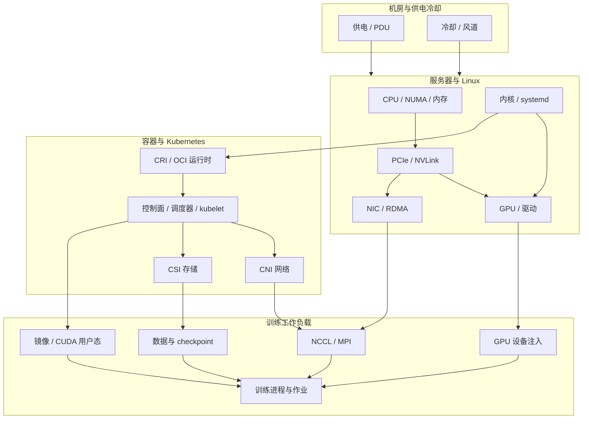
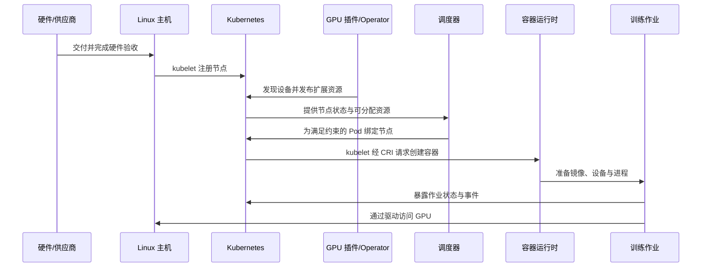
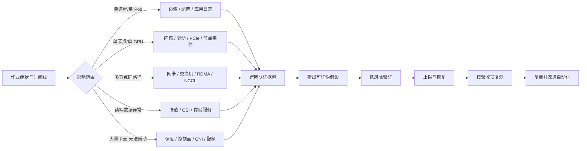

# 第 1 章：岗位能力地图与资源链路

## 学习目标

读完本章后，你应能把“训练任务跑不起来”拆成可验证的故障域；说明 GPU 服务器如何成为 Kubernetes 可调度资源；并明确平台运维、训练平台、网络、存储、硬件和模型研发团队各自提供什么证据。招聘描述列出的年限是岗位经历门槛，课程与实验不能替代生产值班和真实故障处理经验。

## 1.1 这份工作的对象是什么

大规模 GPU 集群运维的对象不是孤立的 Kubernetes 集群，而是一条从供电、冷却、服务器部件、固件、Linux 驱动、GPU 用户态库、容器运行时、Kubernetes 资源、网络和存储，到训练框架与作业的依赖链。一个作业成功，要求这条链上的多个层同时满足约束：节点可用、资源被正确发现、调度满足拓扑与配额、容器拿到预期设备和库、数据可读、分布式通信可达。

因此排障先界定影响面，再沿依赖关系收集证据。不要从单条报错直接跳到重启节点：先回答“是一个 Pod、一张卡、一台节点、一组交换机下的节点，还是全队列受影响？”随后把现象、时间线、最近变更、对象状态、指标和日志放在同一时间轴上。

图 1-1 训练作业依赖的基础设施层次；作业成功取决于多条依赖同时可用。

## 1.2 从服务器到可调度 GPU

资源链路可以按“交付、纳管、发现、调度、使用、观测”六个阶段检查。

1. **交付与验收：** 确认资产、固件、CPU/内存、PCIe、GPU、NIC、磁盘、电源与散热符合采购规格；记录序列号、部件位置和基线。
2. **主机纳管：** 安装受支持的操作系统与内核，配置时间、DNS、仓库、账号和安全基线；确认硬件在操作系统中可见。
3. **驱动与节点健康：** 安装经过验证的 NVIDIA Driver 和网络/存储主机组件；采集驱动、GPU、内核错误、网卡链路与磁盘状态。
4. **Kubernetes 注册：** kubelet 将节点注册到 API；CNI、CSI 和设备插件/Operator 将网络、存储、GPU 能力交给集群。
5. **调度与容器使用：** scheduler 依据资源请求、亲和性、配额和策略绑定 Pod；运行时准备镜像和设备，容器内进程使用 GPU、网络与数据。
6. **持续运营：** 指标、日志、事件和训练侧吞吐共同验证健康；故障时隔离影响面，恢复后按同一验收项复测。

节点 `Ready` 只说明 Kubernetes 的节点就绪条件满足，不等于 GPU、RDMA、共享存储或训练性能已验收。类似地，节点上报了 `nvidia.com/gpu` 数量，也不能单独证明容器可以初始化 CUDA 或多机通信正常。

图 1-2 GPU 从节点交付到作业进程的控制与使用链路；设备资源发布和容器设备注入是两个不同环节。

## 1.3 职责边界与协作接口

团队划分因组织而异，重要的是约定接口和证据，不是假设某组件永远归某一团队。

| 领域 | 运维常见责任 | 需要协作的对象 | 交接时提供的证据 |
| --- | --- | --- | --- |
| 机房与服务器 | 资产、上架、供电散热、部件更换、固件基线 | 供应商、机房团队 | 资产与槽位映射、BMC 告警、传感器/更换记录 |
| Linux 与 GPU | OS 镜像、内核/驱动、节点巡检与隔离 | 硬件、GPU 软件、内核团队 | 内核日志、GPU/Xid/ECC、驱动版本、PCI BDF 与时间线 |
| Kubernetes 平台 | 控制面、节点生命周期、调度策略、CNI/CSI 集成 | 网络、存储、租户平台 | 对象状态、事件、组件日志、变更记录、节点标签和污点 |
| 网络 | 交换机、IB/RoCE、路由、拥塞控制与链路验收 | 集群平台、训练框架 | 端口计数器、拓扑、MTU/GID、链路错误和基线 |
| 存储 | 文件/对象服务、容量、可用性、性能与挂载接口 | 集群平台、数据团队 | 服务端状态、挂载参数、延迟/吞吐、错误时间线 |
| 训练平台/研发 | 作业定义、框架参数、数据访问与通信行为 | GPU/网络/存储运维 | rank 日志、容器镜像摘要、资源请求、复现条件和吞吐指标 |

跨团队工单应记录：唯一事件编号、受影响作业/节点、UTC 或统一时区时间、首次发生和最近变更、可复现步骤、已经排除的假设、原始错误证据、临时止损动作及其结果。共享数据时应遵循组织的数据脱敏和访问控制要求。

图 1-3 生产排障先按影响范围选择证据域，再通过验证和复测闭环；分支是排查入口，不代表故障原因已经确定。

## 1.4 能力地图与学习顺序

学习顺序按依赖关系递进：先 Linux/服务器拓扑，再 Kubernetes 和容器，再 GPU 资源，再训练网络、存储、调度与故障演练，最后练习自动化和变更保障。应在每阶段留下可审阅的产出物，而不是只完成阅读。

| 能力层 | 需能解释/操作 | 可审阅的产出物 |
| --- | --- | --- |
| 主机基础 | 进程、内核日志、NUMA、PCIe、GPU/NIC 可见性 | 节点验收清单与拓扑记录 |
| 容器与 Kubernetes | 控制链路、节点状态、CNI/CSI、镜像与设备注入 | 只读巡检记录和隔离环境实验 |
| 加速器与网络 | Driver/DCGM、Device Plugin、RDMA、NCCL | GPU/网络验收基线和故障树 |
| 数据与调度 | 挂载健康、作业约束、队列与容量 | 数据路径测试方案与容量表 |
| 生产运营 | 告警、SOP、变更、回滚、复盘、跨团队沟通 | 可审计脚本、变更单、事故复盘 |

**学习实验分级：** 无 GPU 的本地环境适合练对象、DNS 和操作流程；单 GPU 隔离节点才能验证驱动、设备注入和 GPU 健康；真实多节点、IB/RoCE 和共享存储环境才能验收对应链路。仿真只能验证流程，不能代替真实拓扑、性能或故障域验收。

## 实践：绘制依赖图并做一次影响面分诊

**前提：** 不需要集群权限或额外软件。准备一张纸或本地 Markdown 文件；使用本章图 1-1 的层次，不能把猜测当成事实。

**步骤：**

1. 选择一个具体症状，例如“多机训练启动后卡在 collective 通信”。记录作业 ID、节点清单、开始时间、最近变更和可见错误；使用虚构数据即可。
2. 将症状映射到作业、GPU、节点、容器、Kubernetes、网络、存储等依赖域，并圈出至少两个可能的共同依赖。
3. 为每个假设指定一条低风险证据：Pod 事件、节点条件、容器镜像摘要、进程日志、GPU/NIC/交换机只读计数器、存储端状态等。注明该证据由哪个团队采集。
4. 排出“先确认影响范围 -> 再验证假设 -> 经授权止损 -> 同项复测”的顺序。不要把重启、驱动重装或网络参数变更列作首个诊断动作。
5. 用图 1-3 检查是否留下可交接的证据包和恢复后的验收项。

**预期结果：** 得到一张标注依赖、责任接口和证据来源的故障域图，以及一份不包含生产变更的排查顺序。若所有假设只依赖单个团队提供的信息，补充跨域证据。

**验证方法：** 由另一位读者只看你的记录，判断影响范围、下一项证据和负责团队；若其必须询问未记录的时间、节点或复现条件，则记录不完整。

**清理：** 若使用临时 Markdown 文件，完成评审后自行删除；不需要连接任何集群。此为桌面推演，验证的是排障结构，不代表真实生产故障已复现。

## 本章产出与验收

- 交付一张从服务器到 Pod/训练作业的依赖图，至少标明 GPU、网络、存储和 Kubernetes 的接口。
- 交付一份责任/证据对照表和一次影响面分诊记录。
- 验收标准：能区分节点 `Ready`、GPU 资源注册、容器内 GPU 可用和多节点训练通信这四个不同健康判据。

## 面试题与答案要点

1. **“服务器到训练 Pod”的 GPU 资源链路有哪些环节？** 答案要点：硬件/固件、Linux/驱动、GPU 设备插件或 Operator、Kubernetes 节点资源、调度绑定、CRI/OCI 运行时设备注入、容器用户态库和训练进程；指出其中的状态不能互相替代。
2. **节点显示 `Ready`，训练 Pod 仍然无法使用 GPU，你会先看什么？** 答案要点：确认 Pod 调度和事件、节点 GPU 扩展资源、设备插件/Operator 状态、运行时注入和容器内 `nvidia-smi`/CUDA 初始化；按层收集证据，不先重启。
3. **NCCL 超时影响同一网络域内多台机器，如何界定排查范围？** 答案要点：作业/rank 与节点映射、网卡端口和拓扑、链路/交换机计数器、MTU/GID/接口选择、NCCL 日志；和网络团队共享同一时间线并验证其他作业。
4. **为什么要先判定影响面？** 答案要点：区分单 Pod、单节点、共享依赖或集群级故障；降低误操作范围，优先保护仍健康任务。
5. **训练研发团队与集群运维团队的交接信息应包含什么？** 答案要点：作业/镜像/配置、rank 与节点映射、时间线、错误日志、资源请求、最近变更、复现步骤和已验证假设；去除敏感信息。
6. **对象存储读慢时，运维应如何与存储和数据团队协同？** 答案要点：说明受影响 bucket/路径、客户端与节点、时间窗口、吞吐/延迟/错误、并发和缓存情况；分别确认服务端与客户端证据，避免只凭 GPU 利用率归因。
7. **资源已注册是否意味着作业有足够 GPU？** 答案要点：否。还需看可分配数量、配额/队列、污点和亲和性、拓扑/整卡约束以及实际容器可见性。
8. **学习路径为什么从服务器拓扑开始，而不是直接学 NCCL？** 答案要点：NCCL 性能和故障依赖 GPU/NIC 拓扑、驱动和网络；不了解底层会难以解释链路问题。
9. **生产故障处理中，“恢复成功”应如何验证？** 答案要点：按原故障路径复测，如 Pod 状态、GPU 初始化、通信 collective、数据读取和吞吐；观察一定窗口并记录恢复证据。

## 官方资料

- Kubernetes 集群架构：https://kubernetes.io/docs/concepts/architecture/
- Kubernetes 设备插件：https://kubernetes.io/docs/concepts/extend-kubernetes/compute-storage-net/device-plugins/
- NVIDIA GPU Operator 文档：https://docs.nvidia.com/datacenter/cloud-native/gpu-operator/latest/
- NVIDIA DCGM 文档：https://docs.nvidia.com/datacenter/dcgm/latest/
