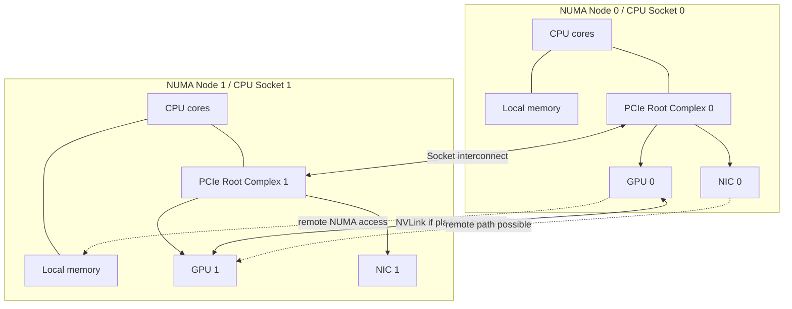
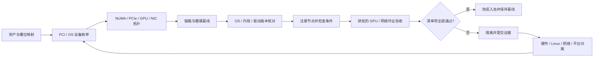
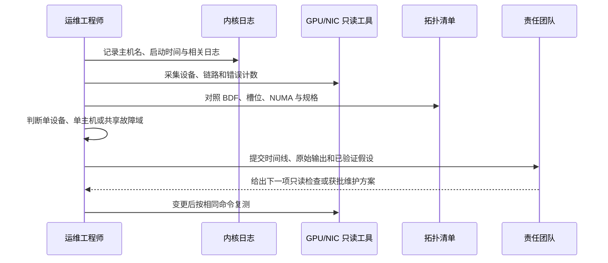

# 第 2 章：Linux、硬件与 GPU 服务器基础

## 学习目标与岗位场景

你需要能够在节点加入 Kubernetes 前确认硬件与操作系统符合基线，并能区分“设备没枚举”“拓扑不合理”“链路降速”“运行中发生硬件错误”等不同问题。本章强调采集和解释证据；固件升级、内核参数、驱动重装、压力测试和部件更换属于变更操作，本章实验不执行这些动作。

## 2.1 Linux 主机巡检的证据层次

Linux 不是 GPU 服务器的全部，但它提供了运维最常用的主机视图：内核负责设备枚举、驱动和中断；systemd 管理服务；journal 提供启动和内核事件；sysfs 暴露设备关系；用户态工具读取 CPU、PCIe、网卡和 GPU 状态。采集时需记录命令版本、主机名、时间和退出码，避免把不同时间的输出拼成一个结论。

只读检查的基本顺序是：

1. `uname -a`、`cat /etc/os-release`：确认内核和发行版版本。
2. `systemctl --failed`、`systemctl status containerd.service`：检查失败服务和容器运行时状态；主机若使用其他 CRI 运行时，应替换为实际 unit 名称。不要为“让它变绿”而直接重启。
3. `journalctl -k -b --no-pager`：查看本次启动内核日志；关注 PCIe AER、驱动初始化、IOMMU、OOM 和设备 reset 等上下文。
4. `lsblk -o NAME,TYPE,SIZE,FSTYPE,MOUNTPOINTS`、`df -hT`：分别检查块设备识别和挂载容量；容量正常不代表存储服务性能正常。
5. `ip -brief link`、`ip -s link`：查看接口管理状态和收发错误；链路 up 不代表 RDMA 或交换网络端到端正常。

生产环境中应从经批准的采集入口读取信息。命令输出可能包含主机名、接口、路径或租户元数据，分享前按组织要求脱敏。对不可见设备，不要立刻执行驱动重载；先记录重启前后状态和日志，确认影响范围及变更授权。

## 2.2 NUMA、CPU、PCIe 与加速器拓扑

NUMA（Non-Uniform Memory Access）系统中，CPU socket/NUMA node 到不同内存区域的访问成本不同。GPU 或高速 NIC 通过 PCIe 连接到某个根端口/CPU 域；跨 NUMA 访问可能增加延迟、消耗互连带宽。PCIe 拓扑还决定设备所在交换芯片、链路宽度/速率以及 GPU 间可用的 NVLink/NVSwitch 路径。仅凭“机器有 8 张卡”无法判断通信性能。

常用只读工具包括：

- `lscpu` 和 `numactl --hardware`：CPU、socket、NUMA 节点和内存分布。`numactl` 未安装时不要为了巡检擅自安装。
- `lspci -D -tv`：PCIe 树与设备 BDF（Domain:Bus:Device.Function）。需要查看某个设备时，从输出中复制其 BDF 到 `BDF` shell 变量，再运行 `lspci -vv -s "$BDF"` 查看链路能力和当前协商状态；不同代际设备与主板实际可支持值不同，应对照平台规格。
- `nvidia-smi topo -m`：GPU、CPU affinity、NUMA 与支持的 NIC 之间的拓扑关系。输出标记和可见对象会随硬件、驱动与工具版本变化。
- `nvidia-smi -q -d PCI,POWER,TEMPERATURE,MEMORY,ECC`：GPU PCIe、功率、温度、显存和 ECC 只读摘要；具体字段依 GPU 型号而异。
- `hwloc-ls`：以图形/层级方式呈现处理器和 I/O 拓扑，便于对比 BIOS/系统配置。

拓扑判断要结合多个来源：BMC/厂商槽位图、`lspci`、GPU 工具、NIC 工具和 Kubernetes 节点标签。GPU 与 NIC 距离近只是拓扑线索，是否启用 GPU Direct RDMA 还取决于驱动、固件、IOMMU/ACS、平台支持和软件配置。不要将 `nvidia-smi topo -m` 的相邻关系单独当作 RDMA 验收结论。



图 2-1 简化的双 NUMA / PCIe 拓扑；实际 GPU 互连和 PCIe 分叉须以目标服务器现场枚举为准。

## 2.3 GPU、NIC 与节点健康

硬件验收要分开记录“识别、链路、健康、负载”四类状态：

- **识别：** GPU/NIC/磁盘是否由 PCI 总线和内核枚举；驱动是否绑定到预期设备。
- **链路：** PCIe 当前速率/宽度是否符合该槽位设计；NIC 端口的速率、双工和错误计数器是否合理。比对前后计数差值比只看累计值更有意义。
- **健康：** GPU ECC/Xid、温度/功耗告警、内核 AER、NIC 重传/丢包、磁盘介质或控制器错误。单一计数器要按型号文档解释。
- **负载：** 空闲状态与训练负载状态下分别采集；无负载时的低功耗/低时钟不代表性能故障。

入池验收应采用规格化清单，而非手工记忆。至少包含资产/机架/U 位、BIOS/BMC/固件版本、CPU/内存/NUMA、GPU 型号/序列和 BDF、GPU/NIC 拓扑、PCIe 链路、磁盘与挂载、接口/交换网络信息、OS/内核/Driver 版本、时间同步、内核事件基线和批准的训练验收结果。驱动或固件变更后重新执行受影响检查项，并保留旧基线。



图 2-2 节点入池验收流程；任何失败都应返回到有证据支持的责任域，未通过节点不进入生产资源池。



图 2-3 服务器问题的证据交接闭环；这套流程本身不执行修复动作。

## 实践：采集一台 Linux GPU 节点的只读拓扑基线

**前提：** 仅在获批的非生产/验收节点执行。系统为 Linux；若没有 GPU，仍可完成 CPU/PCIe/NIC 部分并明确标注 GPU 部分未验证。工具缺失时记录缺项，不要在生产节点自行安装。当前编写环境为 macOS，整套 Linux/GPU 命令**需目标环境验证**。

**步骤/命令：**

```bash
date -Is
hostnamectl
cat /etc/os-release
uname -r
lscpu
numactl --hardware
lspci -D -tv
ip -brief link
ip -s link
journalctl -k -b --no-pager | tail -n 200
nvidia-smi -L
nvidia-smi topo -m
nvidia-smi -q -d PCI,POWER,TEMPERATURE,MEMORY,ECC
```

`numactl` 或 `nvidia-smi` 缺失时，记录“未安装/设备不适用”，不要用 `sudo` 安装。若内核日志权限受限，按组织流程申请只读采集，不要绕过权限。

**预期结果：** 获得带时间和主机标识的 OS/CPU/NUMA/PCIe/NIC/GPU 快照；GPU 型号、BDF 和拓扑能与资产/槽位记录对应。`ip -s link` 和 GPU 错误字段在采集时应记录原值，不能仅凭非零累计数判坏。

**验证方法：** 比较 BMC/资产规格、`lspci` 设备树与 GPU/NIC 工具输出；确认每项关键设备可映射到槽位和 NUMA 节点；对差异标注待确认责任域。若链路速率异常，保存证据并升级给硬件/平台团队，不在实验中重置设备。

**清理：** 命令只读，不创建资源也不改变主机状态。导出的报告按规定存储并脱敏；若重定向到临时文件，审阅后删除该文件。

## 本章产出与验收

- 交付一份不含敏感信息的节点拓扑表：CPU/NUMA、GPU/NIC BDF、PCIe 路径、链路状态和来源。
- 交付一份节点入池检查清单，区分必须项、条件项与需专项网络/训练验收的项目。
- 验收标准：能解释 NUMA locality 和 PCIe 拓扑为何会影响训练通信，并能说明一次只读快照不能代替带负载的验收。

## 面试题与答案要点

1. **什么是 NUMA locality，为什么 GPU 训练运维要看它？** 答案要点：CPU 与内存/设备位于不同 NUMA 域时访问路径和成本不同；CPU 绑核、内存分配、GPU/NIC 放置可能影响延迟和带宽。
2. **`nvidia-smi topo -m` 能证明 GPU Direct RDMA 可用吗？** 答案要点：不能；它描述发现到的拓扑/亲和信息，实际能力还依赖平台、固件、IOMMU/ACS、驱动及配置，并需 RDMA/GPU 通信验收。
3. **如何发现 PCIe 链路降速？** 答案要点：记录设备 BDF，检查 `lspci -vv` 的 LnkCap/LnkSta，与槽位/平台规格、负载和其他节点基线比较；保留日志并交硬件团队分析。
4. **`ip link` 显示 UP 就代表训练网络正常吗？** 答案要点：不代表；还要检查错误计数变化、交换机端口、MTU/GID/路由、RDMA 可用性与端到端带宽/延迟。
5. **GPU ECC 计数非零是否必然要求立即隔离？** 答案要点：结合可纠正/不可纠正类别、计数变化、GPU 型号策略、Xid/训练表现和厂商手册；严重错误按变更和隔离流程处置。
6. **新节点入池至少应记录哪些 GPU 信息？** 答案要点：型号、序列/槽位映射、PCI BDF、驱动版本、健康事件、PCIe/NVLink 拓扑、NUMA affinity、设备注册与获批作业验收结果。
7. **为什么比对 NIC 错误计数要看差值？** 答案要点：累计计数可能来自历史事件；在明确时间窗口比较变化，并关联训练症状和对端/交换机证据。
8. **节点出现 GPU 不可见，第一步是否重载驱动？** 答案要点：否；先确认 PCI 枚举、内核日志、设备 BDF、驱动绑定和影响范围，随后按责任团队和变更流程决定动作。
9. **空闲时 GPU 时钟较低，能否判定性能退化？** 答案要点：不能；需要在可控、获批负载下与同硬件/同软件基线比较，同时看功率、温度、限频原因和吞吐。

## 官方资料

- Linux PCI 总线文档：https://docs.kernel.org/PCI/pci.html
- Linux NUMA memory policy 文档：https://docs.kernel.org/admin-guide/mm/numa_memory_policy.html
- NVIDIA System Management Interface 文档：https://docs.nvidia.com/deploy/nvidia-smi/index.html
- Linux hwloc 项目文档：https://www.open-mpi.org/projects/hwloc/
- NVIDIA 驱动安装指南：https://docs.nvidia.com/datacenter/tesla/driver-installation-guide/
