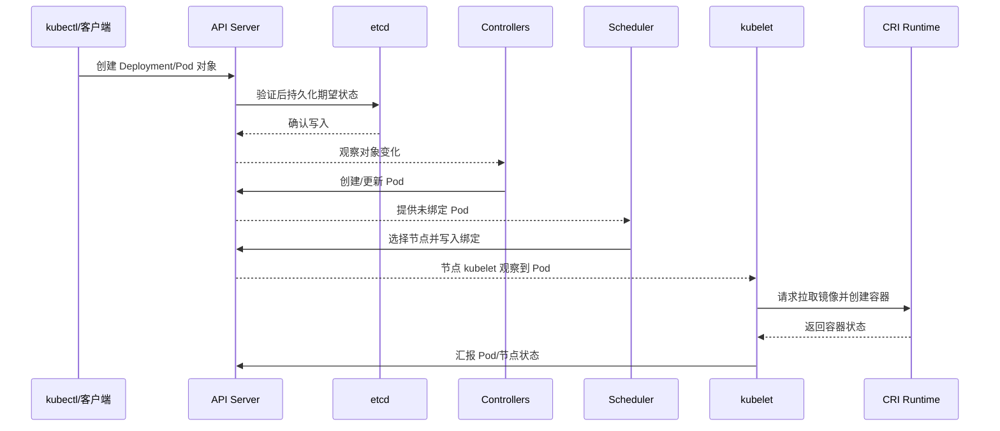
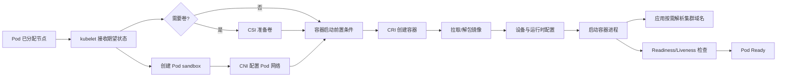
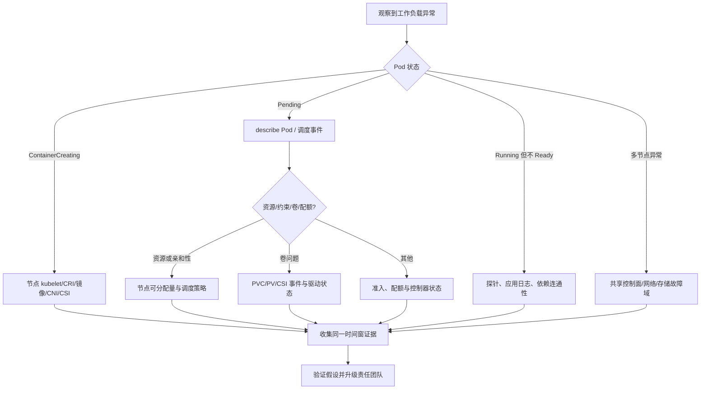

# 第 3 章：Kubernetes 控制面与生产集群排障

## 学习目标与岗位场景

本章建立从 API 对象到节点进程的控制链路视图，覆盖控制面、节点、调度、CNI、CSI、DNS、证书和升级。目标是读懂状态并逐层收集证据；生产集群的升级、节点排空、证书轮换和组件重启必须走组织变更流程。本章实践只创建本机隔离的 kind 集群。

## 3.1 控制面、节点与对象生命周期

Kubernetes 客户端通过 API Server 读写 API 对象；API Server 提供鉴权、准入、验证和持久化接口，etcd 存储集群状态。Controller Manager 中的控制器持续比较期望状态与实际状态并协调对象；Scheduler 为未绑定节点的 Pod 选择满足资源与约束的节点并写入绑定结果。控制面组件可自托管或由云服务商托管，组件具体部署方式会不同。

节点上，kubelet 观察分配给本节点的 Pod 并调用 CRI（Container Runtime Interface）运行时创建容器；CNI 插件负责 Pod 网络接口/地址等网络生命周期；CSI（Container Storage Interface）驱动按存储声明准备卷并挂载。CoreDNS 为集群 Service/Pod 名称解析提供 DNS。这里是职责边界：kubelet 管理 Pod 生命周期，但不自行实现 CNI/CSI 的所有功能。



图 3-1 Pod 控制链路；调度完成只表示节点已选定，容器创建和应用就绪仍可能失败。

Pod 启动过程中，kubelet 和运行时还会调用网络/存储组件。故障定位要看卡在哪一步：Pending 可能是调度约束；容器创建失败可能是运行时、镜像或设备；容器 Running 但 Ready=False 则可能是探针或依赖；Pod IP 正常但域名失败则要单独检查 DNS。



图 3-2 节点侧启动依赖示意；不同运行时版本和插件实现中调用细节可能不同，应结合节点事件和组件日志核验。

## 3.2 调度与节点状态排障

从 `kubectl get pod -o wide` 开始确认 Pod 所在节点、阶段和 IP；`kubectl describe pod` 查看调度事件、资源不足、污点/容忍、卷和镜像错误。Pending 不是一种根因：常见原因有资源请求无法满足、亲和性/拓扑约束无匹配节点、PVC 未绑定、配额或 admission 拒绝。结合 `kubectl get nodes`、`kubectl describe node`、队列/调度器日志进一步确认。

节点 `NotReady` 时，先确定是单节点还是同一故障域内多节点；核对节点 Conditions、最近心跳、Lease、kubelet 与运行时状态、系统资源压力、证书时间、CNI/CSI 和主机日志。集群用户通常看不到托管控制面的主机日志，应使用云平台控制面指标或供应商支持渠道。`kubectl cordon`/`drain` 会改变集群状态，只能在授权维护窗口按工作负载保护策略执行，本章实验不涉及。



图 3-3 Kubernetes 工作负载排障分流；分支帮助选择证据，不等于自动归因。

## 3.3 CNI、CSI、DNS 与证书

**CNI：** 检查 Pod sandbox 创建事件、节点 CNI agent/daemonset、IPAM 分配和节点路由。使用 `kubectl get pods -n kube-system -o wide` 只能看到 Kubernetes 层对象，必要时还要平台管理员提供插件日志/指标。不要手工清理 CNI 状态目录或重启网络 agent。

**CSI：** 检查 PVC/PV 绑定、StorageClass、VolumeAttachment、事件和 CSI controller/node plugin 状态；区分 provision、attach、mount 和应用读写失败。不要在故障处理中删除 PVC/PV、重建底层卷或在宿主机手工卸载生产文件系统。

**DNS：** 先区分 Pod 到 Service IP 通不通、Pod 内对集群域名解析是否失败、外部域名是否失败。检查 CoreDNS Pod、Service/Endpoint、网络策略和节点解析配置。应用缓存的 DNS 结果也可能与 CoreDNS 当前状态不同。

**证书：** 检查 API/组件错误时间、证书到期日、证书颁发者和信任链；确保节点时间同步。使用 `kubectl get csr` 观察 CSR 状态，不要读取或复制 Kubernetes Secret 中的私钥。自建 kubeadm 集群可由授权控制面管理员运行只读的 `kubeadm certs check-expiration`；托管集群则使用厂商控制面状态。更新证书和 kubelet client certificate 是变更动作。

## 3.4 升级与版本兼容

Kubernetes 升级前应确认目标版本的版本偏差策略、插件兼容、API 弃用、etcd 备份恢复方案、控制面与节点升级顺序、维护窗口和回滚边界。一个已应用的 API 对象不一定在目标版本仍可用；应先扫描弃用 API 和 admission/webhook 兼容性。kubelet 版本与 API Server 的版本偏差有官方支持范围，不能从“当前测试集群能工作”推断所有组件兼容。

自建 kubeadm 升级按照官方步骤逐个次版本推进，遵循控制面和工作节点顺序；托管集群遵循供应商控制面升级流程。生产节点 drain、控制面升级和证书更新都不作为本书的随手实验，须有备份、容量和恢复验证方案。失败时先停止后续批次并保留状态；是否回滚取决于具体版本和不可逆 API/数据变化，不能承诺所有升级可原地降级。

## 实践：在本机 kind 集群验证 Pod 启动与集群 DNS

**前提：** 本地安装 Docker、`kubectl` 和 kind；Docker Desktop/容器引擎可用；有获取 kind 节点镜像和 BusyBox 镜像的网络。命令先检查生成的唯一集群名，再创建本机 kind 集群；后续 `kubectl` 命令显式使用该集群 context。不要把命令改指向共享或生产集群。当前编写环境没有安装 kind，因此本实验**需目标环境验证**，文中的预期结果尚未实测。

**步骤/命令：**

```bash
set -euo pipefail
CLUSTER_NAME="k8s-book-lab-$(date +%Y%m%d%H%M%S)"
if kind get clusters | grep -Fxq "$CLUSTER_NAME"; then
  echo "Cluster name already exists; stop and retry with a different name."
  exit 1
fi
kind create cluster --name "$CLUSTER_NAME"
CONTEXT="kind-$CLUSTER_NAME"
kubectl --context "$CONTEXT" get nodes -o wide
kubectl --context "$CONTEXT" get pods -n kube-system -o wide
kubectl --context "$CONTEXT" run dnscheck --rm -i --restart=Never \
  --image=busybox:1.36 -- nslookup kubernetes.default.svc.cluster.local
kubectl --context "$CONTEXT" get events -A --sort-by=.metadata.creationTimestamp
kind delete cluster --name "$CLUSTER_NAME"
```

`set -e` 会在任何检查失败时停止，避免继续操作；遇到中途失败时，从 `kind get clusters` 中核对刚生成的名称，只清理本次实验创建的集群。不要清理原有 context 或其他 kind 集群。

**预期结果：** kind 节点为 Ready；`kube-system` 的核心 Pod 为 Running/Ready；`nslookup` 返回 `kubernetes.default.svc.cluster.local` 的集群 Service 地址；临时 `dnscheck` Pod 在命令结束后删除。

**验证方法：** 确认 `CONTEXT` 等于本次生成的 `kind-$CLUSTER_NAME`，节点查询返回本次集群节点；对 DNS 失败，先看命令返回码和 Pod 事件，再检查 CoreDNS Pod/Service。该实验验证本地 Kubernetes 对象启动和集群 DNS，不验证生产 CNI/CSI 插件、GPU、证书轮换、升级或高可用控制面。

**清理：** 正常流程最后会删除本次创建的集群。若步骤中断，先从本次 shell 记录复制生成的完整集群名，再确认它是本次实验创建的 kind 集群后执行 `kind delete cluster --name "$CLUSTER_NAME"`；不要使用通配符批量删除。

## 本章产出与验收

- 输出一份只读巡检表，覆盖 API/节点/Pod、调度事件、CNI、CSI、DNS、证书和版本兼容。
- 验收标准：能说明 Pod 从 API 对象到进程启动的责任链；面对 Pending、ContainerCreating、Running 不 Ready 和 DNS 错误能选择不同证据；能区分观察命令与会修改集群的维护命令。

## 面试题与答案要点

1. **API Server、etcd、Controller Manager、Scheduler 分别做什么？** 答案要点：API 入口/验证、集群状态持久化、期望与实际状态协调、为未绑定 Pod 选择节点；组件部署形态可因托管方式不同。
2. **Pod Pending 最常见的排查入口是什么？** 答案要点：`describe pod` 中事件；再看节点可分配资源、请求、污点/容忍、亲和性、配额、PVC 和调度器状态。
3. **Pod 已绑定节点但处于 ContainerCreating，检查哪些层？** 答案要点：kubelet、CRI/runtime、镜像拉取、Pod sandbox、CNI、CSI、设备注入和节点日志，按事件中的失败点展开。
4. **节点 NotReady 时为什么不先 drain/reboot？** 答案要点：这些会改变集群并可能扩大影响；先确认范围、Conditions、kubelet/runtime、节点资源/时间和共享依赖，再按维护流程决策。
5. **如何区分 CNI 与 CoreDNS 故障？** 答案要点：CNI 影响 sandbox/IP/基础 Pod 网络；DNS 表现为名称解析。检查 Pod IP/Service IP 连通、CoreDNS Pod/Service/Endpoint 和网络策略。
6. **CSI 卷挂载失败但 PVC Bound 说明什么？** 答案要点：绑定不等于节点端 attach/mount 成功；继续查 VolumeAttachment、事件、CSI controller/node 插件与底层存储。
7. **如何安全排查证书问题？** 答案要点：关联错误时间、节点时钟、证书有效期/信任链和 CSR；不读取私钥，不直接轮换；变更通过管理员和备份/回滚流程。
8. **Kubernetes 升级前的关键检查有哪些？** 答案要点：版本偏差支持、API 弃用、插件/webhook 兼容、备份恢复、容量、逐批顺序、维护窗口、验证和暂停/回滚条件。
9. **为什么 `kubectl get nodes` 全部 Ready 仍不能证明集群可训练？** 答案要点：它不验证 GPU 注册/容器可见、CNI 跨节点性能、CSI 数据路径、队列调度、NCCL 或训练吞吐。
10. **如何避免实验命令误作用到生产集群？** 答案要点：本地 kind 专属 context、命令显式 `--context`、执行前核对 context/集群名、只用实验资源、结束后删指定 kind 集群。

## 官方资料

- Kubernetes 架构：https://kubernetes.io/docs/concepts/architecture/
- Kubernetes 节点：https://kubernetes.io/docs/concepts/architecture/nodes/
- 调度器：https://kubernetes.io/docs/concepts/scheduling-eviction/kube-scheduler/
- 网络插件：https://kubernetes.io/docs/concepts/extend-kubernetes/compute-storage-net/network-plugins/
- CSI 卷：https://kubernetes.io/docs/concepts/storage/volumes/#csi
- Pod 与 Service DNS：https://kubernetes.io/docs/concepts/services-networking/dns-pod-service/
- kubeadm 证书检查：https://kubernetes.io/docs/tasks/administer-cluster/kubeadm/kubeadm-certs/
- kubeadm 升级：https://kubernetes.io/docs/tasks/administer-cluster/kubeadm/kubeadm-upgrade/
- kind Quick Start：https://kind.sigs.k8s.io/docs/user/quick-start/
