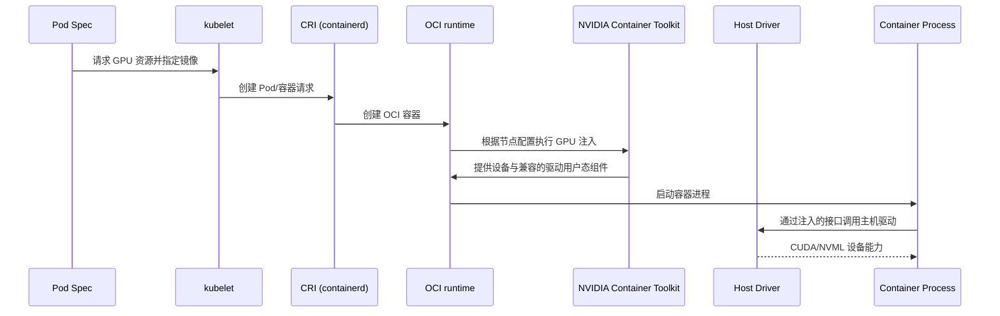
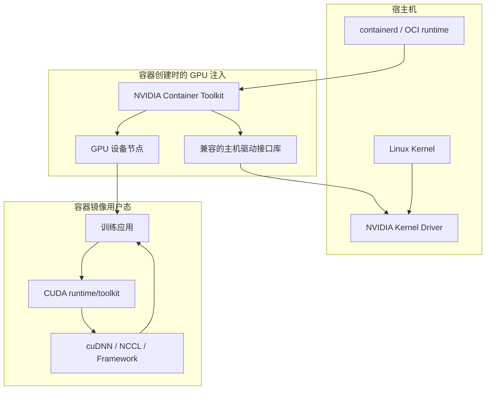
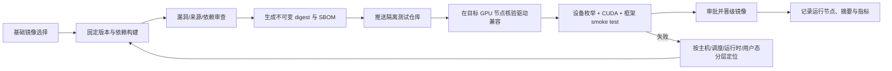

# 第 4 章：容器运行时与 GPU 容器环境

## 学习目标与岗位场景

本章回答一个常见问题：“主机看得到 GPU，为什么容器里看不到，或 CUDA 初始化失败？”读者应能分别检查 Kubernetes CRI 运行时、OCI 容器创建、NVIDIA Container Toolkit 的设备/驱动注入、镜像用户态依赖和框架进程，不把“容器 Running”当作 GPU 健康结论。

## 4.1 从 Kubernetes 到容器进程

Kubelet 通过 CRI 与节点容器运行时通信。containerd 等运行时负责镜像和容器生命周期，并经 OCI runtime（常见为 runc）创建进程。`RuntimeClass` 可以为 Pod 选择集群中配置的不同运行时处理器；它不是自动安装 GPU 驱动或修复设备的开关。

NVIDIA Container Toolkit 提供把 NVIDIA GPU 设备和所需驱动组件暴露给容器的机制。节点运行时需要按官方文档配置；创建容器时，GPU 请求/配置触发相应注入。具体集成取决于 Docker/containerd、Toolkit 和 GPU Operator 的版本/部署方式。Device Plugin 向 Kubernetes 报告可分配 GPU 资源，Toolkit/运行时负责容器创建时的设备可见性；两者职责不同。



图 4-1 GPU 设备进入容器的简化控制链；实际调用路径随运行时集成方式而异，部署后须以目标版本文档核对。

## 4.2 宿主机驱动与容器用户态的兼容关系

NVIDIA Driver 的内核模块运行在宿主机。容器镜像通常携带 CUDA Toolkit 用户态组件、cuDNN、NCCL、框架和应用代码；容器启动时，运行时会暴露设备并注入所需的主机驱动接口/库。不要把宿主机完整驱动安装到应用镜像里，也不要从镜像 CUDA tag 单独推断宿主机驱动一定兼容。

兼容性核对顺序：

1. 记录 GPU 型号、宿主机 Driver 版本、容器 CUDA 运行时/Toolkit 版本、框架构建版本，以及容器 runtime/toolkit 版本。
2. 对照 NVIDIA CUDA Compatibility 文档和相应框架发布说明，核验最低驱动要求、minor-version/forward compatibility 的适用范围与限制。
3. 区分“容器能启动”“`nvidia-smi` 能枚举设备”“CUDA runtime 能初始化”“目标框架 kernel 能运行”这几种验证层级。
4. 以目标 GPU 和正式镜像做获批测试；若升级镜像后失败，回到同一节点/驱动/命令的对照测试，避免同时改变多个变量。

兼容性是具体组合的属性。`nvidia-smi` 顶部显示的 CUDA Version 表示当前驱动支持的 CUDA 版本能力信息，不等于镜像安装的 Toolkit 版本；框架还可能静态或动态链接不同组件。精确结论应有官方兼容矩阵和目标镜像测试记录支持。



图 4-2 主机驱动与容器用户态的分层关系；主机内核驱动、注入的驱动接口库和镜像中的 CUDA/框架不是同一个版本对象。

## 4.3 镜像、设备权限与最小权限

GPU 容器镜像应固定基础镜像 digest 或经过审查的不可变版本，记录 CUDA、框架、cuDNN、NCCL、编译器和系统库版本；构建时尽量使用受信任仓库、漏洞扫描和软件物料清单。使用 `latest` 会使节点间版本漂移难以复现。多阶段构建可以不把编译工具带入最终运行镜像。

设备可见性和权限由运行时与容器设备配置共同决定。应用容器通常不应使用 `privileged: true` 来“解决 GPU 不可见”；这会扩大容器对宿主机的权限。GPU Device Plugin 资源请求、Toolkit 配置和安全策略应由平台统一管理。使用 GPU Operator 时，按其部署文档确认 Driver、Toolkit、Device Plugin、DCGM 等组件各自是否由 Operator 管理，避免手工配置与 Operator 相互覆盖。

故障定位建议按四层建立证据：

| 层 | 只读证据 | 典型问题 |
| --- | --- | --- |
| 主机 | `nvidia-smi -L`、内核日志、驱动服务状态 | GPU 未枚举、驱动未绑定、Xid |
| Kubernetes | 节点 GPU allocatable、Pod 资源请求、插件/Operator 状态、事件 | GPU 未注册、资源不足、Pod 未获分配 |
| 容器创建 | CRI/运行时配置、Toolkit 日志、设备节点与挂载视图 | OCI hook/handler 错误、设备未注入 |
| 容器进程 | `nvidia-smi`、CUDA sample/框架 smoke test、镜像 digest | 用户态不兼容、框架构建或库缺失 |



图 4-3 GPU 镜像发布与验证流程；失败时固定镜像和节点环境后再改变一个变量。

## 实践：在隔离 GPU Linux 节点验证容器设备注入

**前提：** 需要一台非生产、获批使用的 Linux NVIDIA GPU 测试节点；宿主机 Driver 已由管理员安装并可在宿主机执行 `nvidia-smi`；Docker Engine 和 NVIDIA Container Toolkit 已按官方文档配置；本地账户可访问 Docker；固定 digest 的测试镜像或已批准的运行时注入路径能提供容器内 `nvidia-smi`。当前作者环境为 Apple Silicon macOS，没有 NVIDIA GPU、`nvidia-smi` 或 Linux container runtime，本实验**需目标环境验证**。不在本章安装/升级驱动、重写 containerd 配置或运行 privileged 容器。

**步骤/命令：**

```bash
# 先在测试节点确认执行上下文及宿主机设备
hostname
uname -s
nvidia-smi -L

# CUDA_IMAGE 必须是组织批准并核对过的不可变 image@sha256 digest
: "${CUDA_IMAGE:?Set to an approved CUDA image@sha256 digest}"
case "$CUDA_IMAGE" in
  *@sha256:*) ;;
  *) echo "CUDA_IMAGE must use an immutable @sha256 digest" >&2; exit 2 ;;
esac
docker run --rm --gpus all \
  "$CUDA_IMAGE" nvidia-smi
docker image inspect --format='ID={{.Id}} RepoDigests={{.RepoDigests}}' "$CUDA_IMAGE"
```

从批准的镜像仓库获取具体 CUDA 镜像 digest，并先查阅 CUDA Compatibility 文档确认测试节点驱动支持该镜像版本。`docker image inspect` 用于记录实际镜像 ID 和 RepoDigest；将其与 Driver、Docker、Toolkit 版本一起保存，供复测时引用同一镜像。禁止将 `--privileged`、宿主机根目录挂载或额外 capability 加入命令。

**预期结果：** 宿主机命令列出 GPU；容器命令成功退出并列出相同节点上的 GPU、驱动版本和设备状态。容器内的 CUDA 版本字段可能与宿主机 Toolkit 不同，应按兼容文档解释，不能据此误判。

**验证方法：** 记录主机 OS/Driver、容器镜像 digest、Docker 与 Toolkit 版本、命令返回码和 GPU 型号；将宿主机与容器内设备清单对照。该测试只验证 Docker 路径中的基本设备注入与枚举，不证明 Kubernetes Device Plugin、containerd/CRI 路径、训练框架 kernel、MIG、多机 NCCL 或生产性能正确。

**清理：** `--rm` 会在命令结束后删除临时容器；镜像如需释放空间，可在确认它不是其他测试依赖后按测试环境镜像清理流程处理。不要执行主机驱动卸载、设备 reset 或容器运行时重启。

## 本章产出与验收

- 交付一份从节点 GPU 资源注册到容器进程 CUDA 初始化的自检流程，逐层标出证据来源。
- 交付一份镜像兼容性记录，固定 GPU/Driver/运行时/镜像 digest/框架组合。
- 验收标准：能明确区分 Device Plugin 资源注册、运行时设备注入、主机驱动和镜像用户态；能说明 Docker 实验不能代替 Kubernetes 路径验收。

## 面试题与答案要点

1. **Device Plugin 和 NVIDIA Container Toolkit 的职责差异是什么？** 答案要点：Device Plugin 向 kubelet 注册并报告可分配资源；Toolkit 集成到运行时，在容器创建时配置设备/驱动接口可见性。
2. **宿主机 `nvidia-smi` 正常，Pod 中找不到 GPU，如何排查？** 答案要点：看节点 allocatable、插件/Operator、Pod GPU 请求和调度事件、kubelet/CRI/Toolkit 日志、RuntimeClass/handler、容器设备视图；逐层验证。
3. **容器内 `nvidia-smi` 正常但 CUDA 程序报错，可能是什么？** 答案要点：驱动 API 可用但 CUDA 用户态、框架构建、库依赖或 GPU 架构支持仍可能不兼容；跑目标框架 smoke test 并核对版本矩阵。
4. **`nvidia-smi` 显示 CUDA Version 与镜像 CUDA tag 不同，是否必然冲突？** 答案要点：不是直接判据；前者是驱动能力信息，镜像是 Toolkit/runtime 用户态版本，需按 CUDA Compatibility 矩阵判断。
5. **为什么不应用 `privileged: true` 修复设备不可见？** 答案要点：权限面过大，掩盖设备插件/运行时配置问题；应使用平台批准的资源请求和设备注入机制。
6. **如何保证训练镜像可复现？** 答案要点：固定基础镜像 digest、依赖和框架版本；记录 SBOM/构建来源；使用隔离测试和审批晋级，避免 `latest` 漂移。
7. **containerd 与 runc 分别位于哪一层？** 答案要点：containerd 是 CRI/容器生命周期运行时，runc 是 OCI runtime，负责依据 OCI bundle 创建容器进程；具体 shim/调用依版本而异。
8. **RuntimeClass 能解决哪些问题，不能解决哪些问题？** 答案要点：可选择已配置的运行时处理器；不能自动安装驱动、注册 GPU 资源或修复 Toolkit/镜像兼容。
9. **Docker GPU smoke test 成功能证明 Kubernetes GPU 路径正确吗？** 答案要点：不能；Kubernetes 还包含 Device Plugin、kubelet CRI、containerd 配置、Pod 请求与准入等路径。
10. **GPU 容器兼容性记录至少应包含什么？** 答案要点：GPU 型号、宿主机 Driver、Toolkit/运行时、镜像 digest、CUDA/cuDNN/NCCL/框架版本、测试代码与结果。

## 官方资料

- Kubernetes 容器运行时：https://kubernetes.io/docs/setup/production-environment/container-runtimes/
- Kubernetes CRI：https://kubernetes.io/docs/concepts/containers/cri/
- Kubernetes RuntimeClass：https://kubernetes.io/docs/concepts/containers/runtime-class/
- Kubernetes 镜像：https://kubernetes.io/docs/concepts/containers/images/
- NVIDIA Container Toolkit 安装指南：https://docs.nvidia.com/datacenter/cloud-native/container-toolkit/latest/install-guide.html
- NVIDIA Container Toolkit 用户指南：https://docs.nvidia.com/datacenter/cloud-native/container-toolkit/latest/user-guide.html
- NVIDIA CUDA Compatibility：https://docs.nvidia.com/deploy/cuda-compatibility/
- NVIDIA CUDA 容器目录：https://catalog.ngc.nvidia.com/orgs/nvidia/containers/cuda
- Docker GPU 容器文档：https://docs.docker.com/engine/containers/gpu/
- NVIDIA GPU Operator 文档：https://docs.nvidia.com/datacenter/cloud-native/gpu-operator/latest/
