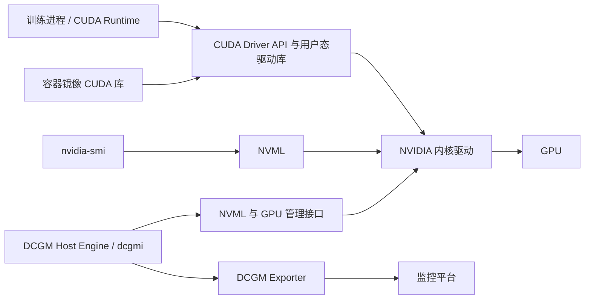
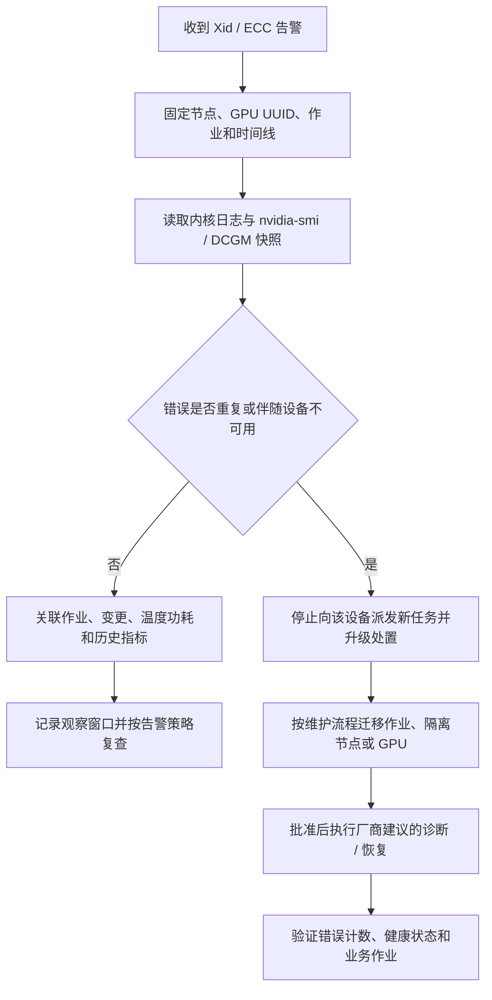
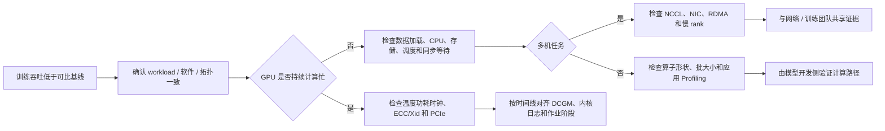

# 第 5 章：NVIDIA GPU 软件栈与硬件故障定位

## 学习目标与岗位场景

完成本章后，应能说明 NVIDIA Driver、CUDA、NVML 与 DCGM 的职责边界；能把 GPU 事件、错误计数、温度/功耗/时钟和训练症状放进同一时间线；能区分“需要继续取证”“可在维护流程中恢复”和“应隔离并升级给硬件/供应商”的情况。常见岗位场景包括 GPU 节点入池巡检、Xid 告警响应、ECC 错误跟踪、掉卡调查、训练吞吐退化分析，以及驱动升级前后的验收。

前置知识：Linux 内核模块、systemd/journal、容器运行时和 Kubernetes 节点基本操作。涉及驱动、固件、GPU reset、节点重启或硬件更换的动作均属于生产变更，需走所在组织的维护审批、作业迁移、排空、回滚和验收流程。

## 软件栈与证据链

Driver 内核模块负责与 GPU 硬件交互；用户态驱动库提供 CUDA Driver API 等接口。CUDA Toolkit 是开发/运行工具与库的集合，其版本号不能简单等同于“必须安装同号驱动”：兼容性取决于驱动分支、CUDA 兼容策略、容器依赖和应用使用的功能，必须查对应版本矩阵。NVML 是管理与遥测 API，`nvidia-smi` 是常用管理 CLI，许多显示字段来自 NVML。DCGM 面向数据中心 GPU 的监控、健康检查和诊断，可通过 Host Engine、CLI 或 Exporter 接入平台。



图 5-1：训练调用、宿主机驱动和管理遥测的关系。容器提供用户态 CUDA 组件，设备访问与驱动仍依赖宿主机配置；具体注入方式取决于容器运行时和 NVIDIA Container Toolkit。

排障先保留证据再恢复。至少记录节点名、GPU UUID、时间及时区、驱动版本、GPU 型号、容器/作业 ID、最近变更、相关 Xid/ECC 记录、DCGM 指标和节点内 GPU/NIC 拓扑。GPU index 可能随启动、设备变化或容器可见设备映射而变化；跨日志关联优先使用 UUID 与节点身份。`nvidia-smi` 的一次快照不能代表历史健康，也不能单独证明故障根因。

## Xid、ECC 与硬件错误定位

Xid 是 NVIDIA 驱动通过系统日志报告的 GPU 错误事件标识。Xid 代码用于缩小调查范围，不应脱离对应驱动版本的 NVIDIA Xid 文档，直接映射成唯一硬件根因。相同代码需要结合发生频率、GPU UUID、上下文、驱动/固件、PCIe 状态、作业行为、宿主机内核日志及供应商建议判断。



图 5-2：错误事件处置顺序。停止派发和隔离方式需由集群平台实现；不能在仍承载作业时直接 reset GPU 或重启节点。

ECC 需要区分可纠正与不可纠正、volatile 与 aggregate 等统计口径，并记录采集时间及重启/清零边界。当前计数为零并不能证明过去无错；aggregate 计数与运行期计数也不能直接混为一个时间窗。出现不可纠正错误、错误持续增长、设备消失或训练反复失败时，应结合 DCGM 健康结果与 NVIDIA 对应错误说明升级处理；不要通过反复重置设备“清掉”证据。具体可用字段因 GPU 架构、驱动和管理接口版本而异。

## 性能退化定位

性能问题要先建立同一工作负载、同一软件版本和同一拓扑的基线。关注 GPU 利用率、显存占用、功率、温度、时钟、PCIe 错误/重放、CPU/NUMA 绑定、数据加载、存储等待、网络通信和作业阶段时间。利用率低既可能是 GPU 空闲，也可能是同步等待、输入管道停顿或采样口径问题；利用率高也不自动等于效率高。比较前要确认指标采样间隔、设备 UUID 和容器映射一致。



图 5-3：性能退化的跨层分流。该图用于组织证据，不表示单一指标能确定根因。

DCGM 可用于查询 GPU 状态、配置健康监控和执行受控诊断。诊断等级及其测试范围随 DCGM 版本、GPU 型号和权限而异；会产生计算负载或占用设备的诊断只能在隔离节点、明确窗口和已迁移作业后运行。短测通过也不能替代长时间训练稳定性、网络和存储验收。

## 实验：GPU 健康只读快照

**实验类型：** 只读检查，不安装软件、不启用/修改健康策略、不运行压力诊断。

**前提：** 有一台获准查看的 Linux GPU 实验节点；已安装 NVIDIA 驱动和 `nvidia-smi`。若使用 `dcgmi`，需已安装 DCGM CLI 且 DCGM Host Engine 正常。当前无可确认的 NVIDIA GPU 实验环境，本实验状态为“需目标环境验证”。

**步骤：**

```bash
# 只列出设备身份和型号
nvidia-smi -L

# 输出只读管理快照；重点记录 Driver Version、GPU UUID、温度/功耗/时钟、ECC、PCIe 和错误信息
nvidia-smi -q

# DCGM 已安装且 Host Engine 可用时再执行
dcgmi discovery -l
dcgmi health -c
```

**预期与验证：** `nvidia-smi -L` 返回当前可见 GPU 及 UUID；`nvidia-smi -q` 返回驱动和管理信息。DCGM 命令在可用环境中应列出设备，健康检查结果按已启用的监控策略报告。将结果与节点资产清单中的 UUID/型号、同一时间的内核日志和监控平台记录交叉核验。没有配置健康监控或服务不可用时，记录为“未检查/不可用”，不要为完成实验而写入配置。

**清理：** 无持久配置和临时文件，无需清理。实验不触发 GPU 压测，也不宣称验证了训练稳定性。

## 生产变更边界与交付物

驱动安装/升级、固件更新、GPU reset、节点重启和硬件替换都需单独变更单。变更单至少包括：目标节点与作业清单、驱动/内核/Toolkit/Operator 兼容矩阵、维护窗口、节点排空和回滚条件、带外访问、供应商升级路径，以及变更后 GPU 枚举、DCGM 健康、容器可见性和代表性训练的验收结果。若设备复位条件、GPU 共享状态或恢复能力不明确，应停止并升级给硬件/平台负责人。

本章产出：一份按 GPU UUID 记录的健康检查表；一份 Xid/ECC 故障时间线模板；一份驱动变更前后验证清单。

## 面试题与答案要点

1. **Driver、CUDA Toolkit、NVML、DCGM 各自负责什么？** Driver 与硬件交互；CUDA Toolkit 提供开发/运行库；NVML 提供管理接口；DCGM 面向数据中心 GPU 监控与诊断。
2. **容器内 CUDA 版本与宿主机驱动版本号不同，是否必然不兼容？** 不是；需按 NVIDIA CUDA Compatibility 和实际应用功能核对驱动下限、兼容策略及镜像依赖。
3. **收到 Xid 告警，你先做什么？** 固定时间、节点、GPU UUID、作业和变更，保留内核日志与 DCGM/`nvidia-smi` 证据，再查对应版本的 Xid 说明。
4. **看到一次 Xid 就能判定 GPU 硬件坏了吗？** 不能；需要看代码语义、重复性、错误上下文、设备健康和供应商诊断。
5. **如何判断 ECC 告警是否还在增长？** 统一采集时点和字段口径，区分可纠正/不可纠正及 volatile/aggregate，并比较同一 UUID 的时间序列。
6. **为什么不应立即 reset 或重启节点？** 可能中断作业、扩大影响并破坏现场证据；必须先确认作业状态、隔离方式和变更授权。
7. **GPU 利用率高说明训练性能正常吗？** 不说明；仍需看有效吞吐、时钟/功耗/温度、错误、同步等待和训练阶段耗时。
8. **训练吞吐突然下降，如何区分 GPU、存储与网络问题？** 对齐任务阶段和时间线，检查 GPU 指标与日志、数据加载/存储等待、多机通信和慢 rank，逐层验证。
9. **`nvidia-smi` 显示正常，能否证明节点健康？** 不能；它是快照且覆盖有限，仍要结合 DCGM、内核/BMC、PCIe、长时作业与业务指标。
10. **驱动升级验收至少包含什么？** 版本/兼容核验、设备枚举、健康检查、容器 GPU 可见性、代表性工作负载及回滚条件验证。

## 官方资料

- NVIDIA Driver Installation Guide：<https://docs.nvidia.com/datacenter/tesla/driver-installation-guide/index.html>
- NVIDIA CUDA Compatibility：<https://docs.nvidia.com/deploy/cuda-compatibility/index.html>
- NVIDIA System Management Interface (`nvidia-smi`)：<https://docs.nvidia.com/deploy/nvidia-smi/index.html>
- NVIDIA Management Library API Reference：<https://docs.nvidia.com/deploy/nvml-api/index.html>
- NVIDIA Data Center GPU Manager User Guide：<https://docs.nvidia.com/datacenter/dcgm/latest/user-guide/index.html>
- NVIDIA Xid Errors：<https://docs.nvidia.com/deploy/xid-errors/latest/index.html>

文档整理日期：2026-10-06。诊断码释义、字段支持和版本兼容性以目标驱动/硬件对应的官方版本文档为准。
