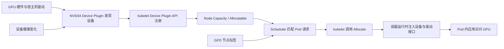
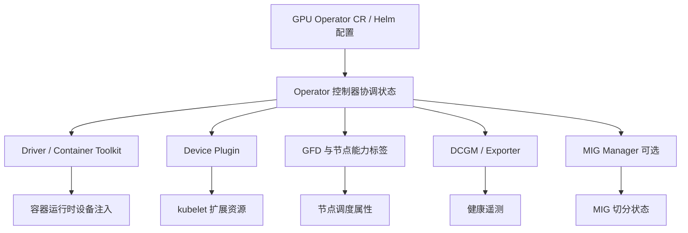
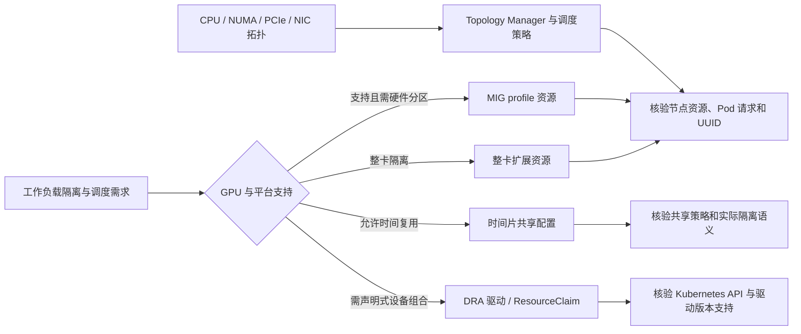

# 第 6 章：Kubernetes GPU 资源管理

## 学习目标与岗位场景

本章说明物理 GPU 如何被 Kubernetes 发现、登记、调度并交给容器使用。完成后，应能沿 Device Plugin、GPU Operator、GPU Feature Discovery（GFD）、节点资源状态与 Pod 分配链路定位“节点有卡但资源未注册”“Pod Pending”“容器看不到 GPU”等问题，并能根据 GPU 形态和集群版本评估整卡、MIG、时间片共享或 Dynamic Resource Allocation（DRA）。

前置知识：Kubernetes 节点和 Pod 调度、容器运行时、NVIDIA 驱动栈。本章实验要求专用 GPU 测试集群和独立命名空间；不得在生产命名空间试跑资源申请。

## 从硬件到容器的注册链路

Kubernetes Device Plugin API 让厂商插件向 kubelet 注册扩展资源，并处理设备列表、分配和健康状态。NVIDIA Device Plugin 通常将整卡呈现为 `nvidia.com/gpu`，但具体暴露的资源名、MIG 策略和共享模式由插件配置及版本决定。调度器基于 Node 的 Capacity/Allocatable 与 Pod 请求做资源决策；设备注入由节点侧插件/runtime 完成。`kubectl describe node` 中可见资源不等于容器内 CUDA 已可用，因此验收需跨越调度与容器两层。



图 6-1：扩展设备资源从发现到容器访问的链路。GFD 标签用于描述节点能力和调度约束，不能替代资源申请或设备分配。

GPU Operator 用 Kubernetes Operator 模式管理一组 NVIDIA GPU 软件组件，具体组件、启用方式、安装/升级流程随 Operator 版本和配置而变。部署前须核对目标 Kubernetes、GPU Driver、CUDA、Container Toolkit、Device Plugin、DCGM、GFD、MIG Manager 等兼容矩阵。Operator 安装驱动可能涉及宿主机内核模块、特权容器及节点级变更；只在受控集群按照官方安装指南操作。既有平台若由主机镜像统一管理驱动，应避免 Operator 与主机管理流程争抢驱动生命周期。



图 6-2：GPU Operator 的控制关系示意。组件是否启用、是否由 Operator 安装驱动，以及组件版本均由实际 release 和安装配置决定。

## 整卡、MIG、共享与拓扑

整卡分配适合需要独占整块 GPU 的作业。MIG（Multi-Instance GPU）在支持的 GPU 上把设备切分成受硬件支持的实例；可用配置和实例数量依 GPU 架构、显存/计算片布局、驱动与管理工具版本而异。MIG 的设备资源往往按 profile 映射到可调度资源，切换分区可能要求重建实例并影响正在运行的 Pod，所以先确认驱逐与维护策略。

时间片共享让多个工作负载复用同一物理 GPU 的执行时间，通常不提供与 MIG 相同的硬件故障隔离/显存隔离语义；配置细节依插件/Operator 版本。不能只看节点上资源计数就推断隔离强度。拓扑信息可帮助把 GPU、CPU/NUMA 和 NIC 位置作为调度依据；Topology Manager、CPU Manager、Device Plugin 的策略须与工作负载及 kubelet 配置协同，单独添加标签不保证实际亲和性。



图 6-3：GPU 资源方式的选择维度。DRA、MIG 与共享能力须按具体 Kubernetes、NVIDIA 驱动和插件版本核验，不能仅凭接口名称推断已可用于生产。

DRA 将设备需求建模为可声明和分配的资源，接口/API 与驱动支持受 Kubernetes minor 版本、feature gate、资源 API 版本及厂商驱动版本影响。上线前从目标 apiserver 查询实际资源 API，核对 Kubernetes 当前版本文档和 NVIDIA DRA driver 的兼容表，再做隔离集群试验。不要把某个版本的 beta/GA 状态直接套用到其他版本。

## 排障顺序

1. **设备层：** 节点本地 `nvidia-smi -L` 是否能发现设备，驱动是否加载，是否有 Xid/ECC 或节点硬件告警。
2. **控制器层：** Device Plugin/Operator Pod 是否运行；检查 namespace、Pod 日志、事件、DaemonSet 覆盖节点情况和版本配置。
3. **注册层：** `kubectl describe node` 的 Capacity/Allocatable 是否包含预期资源；区分 `capacity` 与扣除保留/已分配后的 `allocatable`。
4. **调度层：** Pod request、节点选择器、污点/容忍、配额、资源余量、MIG profile 标签及拓扑约束是否冲突。
5. **运行层：** 分配成功后，在专用测试 Pod 检查设备可见性和框架调用；设备可见不等于 CUDA kernel 或训练通信正确。
6. **回收层：** 删除测试 Pod 后确认分配释放；若插件报告 unhealthy 或资源数不一致，不通过重启所有 GPU 组件来掩盖状态。

## 实验：只读盘点并在隔离集群验证单卡 Pod

**前提：** 用专用 GPU 测试集群中明确命名的 kubeconfig context 和预先建立的 `gpu-lab` 命名空间；确认一个空闲测试 GPU、Device Plugin 已注册扩展资源、所选 CUDA 镜像兼容且固定到已批准的 image digest，并且镜像或已批准的运行时注入路径能提供 `nvidia-smi`。目标节点需有经核对的 `kubernetes.io/hostname` 标签，且其 taint 不会阻止此测试 Pod，或已获批添加所需 toleration。步骤 B 需要 Python 3 生成唯一 Pod 名。执行前核对目标 context 返回的节点信息，确认它是批准的实验集群。无法提供该集群时，实验状态为“需目标环境验证”。

**步骤 A：只读盘点。**

```bash
: "${GPU_LAB_CONTEXT:?Set GPU_LAB_CONTEXT to the approved GPU lab context}"
: "${GPU_NODE:?Set GPU_NODE to a node from the approved GPU lab}"
GPU_NODE_HOSTNAME="$(kubectl --context "$GPU_LAB_CONTEXT" get node "$GPU_NODE" -o jsonpath='{.metadata.labels.kubernetes\.io/hostname}')"
: "${GPU_NODE_HOSTNAME:?The approved node must have a kubernetes.io/hostname label}"
echo "GPU node=$GPU_NODE hostname-label=$GPU_NODE_HOSTNAME"
kubectl --context "$GPU_LAB_CONTEXT" get nodes -o wide
kubectl --context "$GPU_LAB_CONTEXT" get pods -A | grep -E 'gpu-operator|device-plugin|feature-discovery|dcgm' || true
kubectl --context "$GPU_LAB_CONTEXT" api-resources --api-group=resource.k8s.io
kubectl --context "$GPU_LAB_CONTEXT" describe node "$GPU_NODE"
kubectl --context "$GPU_LAB_CONTEXT" -n gpu-lab get resourcequota,limitrange
kubectl --context "$GPU_LAB_CONTEXT" -n gpu-lab get events --sort-by=.lastTimestamp
```

上一步的节点描述输出用于核对 Capacity/Allocatable、标签、污点及近期事件。`api-resources` 没有列出预期 DRA API 时，停止 DRA 实验，按该集群 Kubernetes 版本的官方文档判断原因。

**步骤 B：隔离的单卡烟雾测试。** 在步骤 A 同一终端中保留 `GPU_LAB_CONTEXT`、`GPU_NODE` 和 `GPU_NODE_HOSTNAME`。manifest 用必需的 hostname label 约束 scheduler 只在已确认的实验节点上放置 Pod；若该节点有阻断 taint，应先由集群管理员确认获批 toleration，不要移除 taint。以下脚本用随机 UUID 生成此次专用 Pod 名，并用 `create` 防止覆盖已有对象；镜像需按实验环境的驱动兼容矩阵调整。该示例会调度并短时占用一张 GPU。

```bash
GPU_SMOKE_NAME="gpu-smoke-$(python3 -c 'import uuid; print(uuid.uuid4().hex)')"
: "${GPU_SMOKE_IMAGE:?Set to an approved CUDA image@sha256 digest}"
case "$GPU_SMOKE_IMAGE" in
  *@sha256:*) ;;
  *) echo "GPU_SMOKE_IMAGE must use an immutable @sha256 digest" >&2; exit 2 ;;
esac
kubectl --context "$GPU_LAB_CONTEXT" -n gpu-lab create -f - <<YAML
apiVersion: v1
kind: Pod
metadata:
  name: ${GPU_SMOKE_NAME}
spec:
  restartPolicy: Never
  nodeSelector:
    kubernetes.io/hostname: "${GPU_NODE_HOSTNAME}"
  containers:
    - name: gpu-smoke
      image: "${GPU_SMOKE_IMAGE}"
      command: ["nvidia-smi", "-L"]
      resources:
        limits:
          nvidia.com/gpu: 1
YAML

kubectl --context "$GPU_LAB_CONTEXT" -n gpu-lab wait --for=jsonpath='{.status.phase}'=Succeeded "pod/$GPU_SMOKE_NAME" --timeout=180s
kubectl --context "$GPU_LAB_CONTEXT" -n gpu-lab get pod "$GPU_SMOKE_NAME" -o wide
kubectl --context "$GPU_LAB_CONTEXT" -n gpu-lab logs "$GPU_SMOKE_NAME"
```

**预期与验证：** 只读盘点显示 GPU 节点及控制器状态；烟雾 Pod 进入 `Succeeded`，日志列出分配给该 Pod 的可见设备。若等待超时或失败，先用 `kubectl --context "$GPU_LAB_CONTEXT" -n gpu-lab describe pod "$GPU_SMOKE_NAME"` 和 `kubectl --context "$GPU_LAB_CONTEXT" -n gpu-lab get events --sort-by=.lastTimestamp` 保留证据，再查镜像、runtime、设备插件和驱动日志；若 Pending，重点核对 Pod Events 与节点 Allocatable。此测试只验证一次设备分配/可见性，不验证 MIG 隔离、拓扑亲和或训练性能。

**清理：** 完成后删除准确的测试 Pod，并验证资源归还。若命令未创建对象，删除返回 NotFound 可忽略。

```bash
kubectl --context "$GPU_LAB_CONTEXT" -n gpu-lab delete pod "$GPU_SMOKE_NAME" --wait=true
kubectl --context "$GPU_LAB_CONTEXT" -n gpu-lab wait --for=delete "pod/$GPU_SMOKE_NAME" --timeout=60s
kubectl --context "$GPU_LAB_CONTEXT" describe node "$GPU_NODE"
```

删除后，Pod 的 `NotFound`/wait-for-delete 成功是预期结果；在节点描述的 Allocated resources 中确认 GPU 请求已释放。Node 的 Capacity/Allocatable 是设备总量，不应期待它们随单个 Pod 删除而变化。

## 本章产出

- 一张从 GPU UUID 到 Pod 的资源状态链路图。
- 一份 GPU 节点入池验收表：驱动/插件版本、资源注册、标签、健康、分配/释放、容器可见性和回滚条件。
- 一份目标集群的版本兼容矩阵，单独标出尚未验证的 DRA、MIG 与共享能力。

## 面试题与答案要点

1. **Kubernetes 如何获知节点上有 GPU？** 节点侧 Device Plugin 通过 kubelet Device Plugin API 注册设备/资源，kubelet 更新 Node Capacity/Allocatable。
2. **GFD 标签和 GPU 资源申请有什么区别？** 标签表达节点特征供选择/调度约束；扩展资源 request 才表达要分配的设备份额。
3. **Operator 显示 Running，但 GPU Pod 仍 Pending，如何排查？** 看插件 DaemonSet 覆盖、注册资源、Pod request、可分配余量、taint/selector、配额与事件。
4. **为什么节点 Capacity 有 GPU，但 Pod 里仍看不到设备？** 资源注册与容器 runtime 注入是不同链路；查 Allocate、设备插件、容器运行时和驱动挂载。
5. **MIG 与时间片共享的核心差异是什么？** MIG 是受硬件支持的实例划分；时间片是执行复用，隔离语义不同，具体能力需按设备与版本验证。
6. **修改 MIG 配置前要确认什么？** GPU 型号/profile 支持、当前实例/Pod、变更影响、插件识别方式、排空窗口及恢复步骤。
7. **Topology Manager 单独开启就能保证 GPU/NIC 亲和吗？** 不能；kubelet、CPU Manager、设备插件策略和实际拓扑须匹配，并通过节点分配结果验证。
8. **何时考虑 DRA？** 当目标 Kubernetes API、厂商驱动和工作负载都支持其声明式资源模型，且完成版本矩阵及隔离环境验证后。
9. **资源已释放但 Node Allocatable 未恢复，应如何处理？** 查 Pod 是否仍占用、插件健康/设备列表、kubelet 事件和组件日志，再按节点级恢复流程处置。
10. **GPU Pod 启动成功并能运行 `nvidia-smi`，验收是否完成？** 只完成了设备可见性烟雾测试，还应验证框架、代表性 kernel/训练、健康监控及所需拓扑语义。

## 官方资料

- Kubernetes Device Plugins：<https://kubernetes.io/docs/concepts/extend-kubernetes/compute-storage-net/device-plugins/>
- Kubernetes Dynamic Resource Allocation：<https://kubernetes.io/docs/concepts/resource-management/dynamic-resource-allocation/>
- Kubernetes Topology Manager：<https://kubernetes.io/docs/tasks/administer-cluster/topology-manager/>
- NVIDIA GPU Operator：<https://docs.nvidia.com/datacenter/cloud-native/gpu-operator/latest/>
- NVIDIA Kubernetes Device Plugin：<https://github.com/NVIDIA/k8s-device-plugin>
- NVIDIA GPU Feature Discovery：<https://github.com/NVIDIA/gpu-feature-discovery>
- NVIDIA Kubernetes DRA Driver：<https://github.com/kubernetes-sigs/dra-driver-nvidia-gpu>

文档整理日期：2026-10-06。GPU Operator chart、Device Plugin、DRA driver 和 Kubernetes API 的支持矩阵必须在目标版本 release notes 中再次核对。
