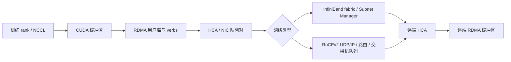
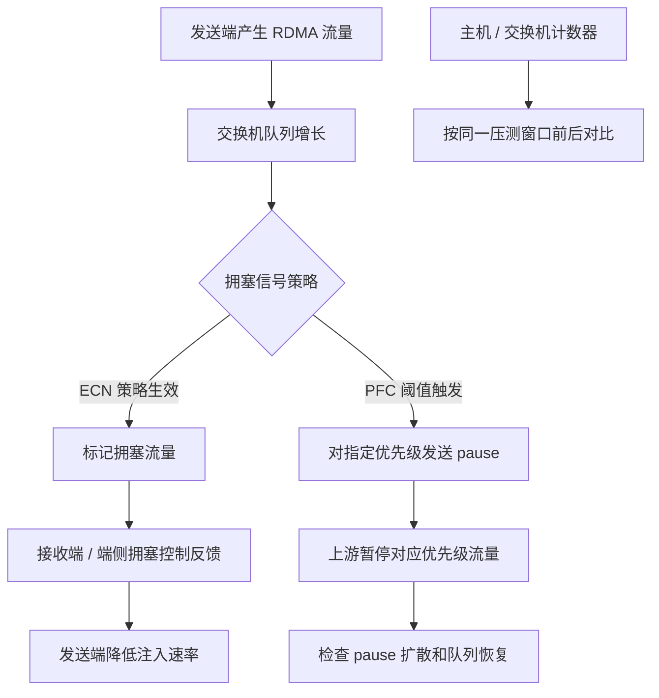

# 第 7 章：IB/RoCE 训练网络与 RDMA

## 学习目标与岗位场景

本章帮助 GPU 平台运维参与训练网络方案验收和故障定位。应能解释 InfiniBand（IB）与 RoCEv2 的基本路径，理解 Remote Direct Memory Access（RDMA）、HCA、GID、MTU、PFC/ECN 的作用和边界；能组织端口、路由、计数器和端到端通信证据；能把网络侧观测交给网络团队，而不在平台节点上擅自改交换机配置。

网络可靠性是端主机、HCA 固件/驱动、线缆/光模块、交换机、路由/QoS 与训练库共同决定的。IB 与 RoCE 的控制面及交换网络运维不同，不要把某一厂商 CLI、计数器名或默认参数当作通用标准。

## IB、RoCE 与 RDMA 路径

IB 网络依赖 IB fabric 与子网管理器，端口状态、分区和路径由 fabric 管理；RoCEv2 将 RDMA 流量承载在 UDP/IP 上，需 IP、路由、交换机队列和拥塞控制等共同正确。两者都可能提供 RDMA verbs，但测试工具、命名、GID 选择和错误计数方式取决于驱动及网络实现。GPU Direct RDMA 是否启用还涉及 GPU、NIC、PCIe/IOMMU、驱动和软件栈支持；看到 RDMA 可用不自动证明数据路径已从 GPU 直达 NIC。



图 7-1：训练通信中的 RDMA 数据路径。实际 GPU Direct 路径是否成立要由平台配置和目标拓扑实测确认。

验收应分层进行：物理端口和链路状态、驱动/HCA 识别、IP/子网/路由、MTU 一致性、GID 类型与索引、对端连通、错误/丢包/重传/拥塞计数器、verbs/perftest 通信，以及实际 NCCL 多机测试。`ping` 或普通 TCP 吞吐不能替代 RDMA 端到端验证。MTU、GID 与 QoS 配置需要端到端一致；RoCE 环境中 GID 表可能由网络接口和地址自动生成，不能复制另一节点的索引假设。

## PFC、ECN 与拥塞证据

PFC（Priority Flow Control）在指定优先级上发送 pause 控制，帮助构建局部无损行为；不当配置可能把拥塞扩散成队头阻塞或暂停风暴。ECN（Explicit Congestion Notification）通过标记可排队拥塞信号，由端系统按拥塞控制机制响应。两者是否启用、适用优先级、阈值、队列映射和端侧算法属于网络设计决策；不能只在主机上“打开 PFC”就认为 RoCE 网络正确。IB 具有不同的链路层流控与拥塞管理机制，不能照搬以太网 PFC 检查表。



图 7-2：PFC 与 ECN 的概念性作用链。具体报文处理、阈值与反馈策略由网络设备和端侧配置决定；图不表示两者可互相替代。

出现训练吞吐抖动、NCCL hang 或丢包时，按同一时间窗采集两端口和交换机的错误/拥塞计数器，确认受影响的优先级、流量路径及其他并发作业，再与 RDMA 压测、NCCL 日志和作业 rank 对齐。单一 PFC pause 计数器增大不必然意味着故障；需要比较变化率、错误帧、丢弃、重传、ECN 标记和任务症状。阈值及计数器语义按厂商文档核对。


图 7-3：从主机到网络的验收和故障协作顺序。每一步保存原始输出和时间戳，配置变更由网络变更流程执行。

## 实验：隔离双节点 RDMA 连通与计数器对比

**实验状态：需目标环境验证。** 当前工作区没有两台已授权的 IB/RoCE 节点，不能声称已运行或证明带宽。该实验会产生网络流量，只允许在专用实验 fabric/端口、无生产训练负载的窗口开展。

**前提：** 两台相互连通的实验节点、正确安装的 RDMA 驱动和 `rdma-core`/perftest 工具；网络负责人需确认 HCA、端口、实验接口、允许的 GID 和 fabric 路径。每台主机分别设置本地 `HCA_DEVICE`、`PORT_NUMBER`、`TEST_IFACE`、`PEER_EXPERIMENT_IP` 和 `NETWORK_TYPE`（`ib` 或 `roce`）；RoCE 另设置本机 GID 表中对应实验接口的 `GID_INDEX`。GID 索引按主机分别确认，可能不同。所有值从只读设备/GID 信息和网络负责人提供的实验分配中取得。不要在共享生产 fabric 上自行跑基准。

**步骤：**

1. 在两节点各自的 Bash 终端中设置接口与对端地址，并保存只读基线；值来自批准的实验网络分配：
   ```bash
   : "${TEST_IFACE:?Set to the approved experiment interface}"
   : "${PEER_EXPERIMENT_IP:?Set to the peer experiment IP}"
   rdma link show
   ibv_devinfo
   ip -details link show "$TEST_IFACE"
   ip route get "$PEER_EXPERIMENT_IP"
   ethtool -S "$TEST_IFACE"
   ```
   `ethtool -S` 的字段由 NIC 厂商和驱动决定；交换机端口/队列/PFC/ECN 计数器由网络团队提供。
2. 核对两端端口、MTU、接口/IP 路由和 GID 表；`show_gids` 是否可用依发行版/OFED 包。RoCE 的 `GID_INDEX` 取本机实验接口当前表中与实验地址匹配的条目，节点 A 与节点 B 分别设置，不假定索引相同或固定。
3. 在节点 B 的 Bash 终端设置本机 `NETWORK_TYPE`、`HCA_DEVICE`、`PORT_NUMBER`；RoCE 还设置本机 `GID_INDEX`。先以安装版本 `ib_write_bw --help` 核对 `-x` 参数及设备名，然后启动服务端：

   ```bash
   : "${NETWORK_TYPE:?Set NETWORK_TYPE to ib or roce}"
   : "${HCA_DEVICE:?Set the local RDMA device name}"
   : "${PORT_NUMBER:?Set the local HCA port number}"
   if [ "$NETWORK_TYPE" = "roce" ]; then
     : "${GID_INDEX:?Set the local GID index verified for this interface}"
     timeout 60s ib_write_bw -d "$HCA_DEVICE" -i "$PORT_NUMBER" -x "$GID_INDEX"
   elif [ "$NETWORK_TYPE" = "ib" ]; then
     timeout 60s ib_write_bw -d "$HCA_DEVICE" -i "$PORT_NUMBER"
   else
     echo "NETWORK_TYPE must be ib or roce" >&2
     exit 2
   fi
   ```

4. 在节点 A 的 Bash 终端设置本机 `NETWORK_TYPE`、`HCA_DEVICE`、`PORT_NUMBER`、`PEER_EXPERIMENT_IP`；RoCE 还设置节点 A 本机核验过的 `GID_INDEX`。用节点 B 的实验控制地址发起有限轮次测试：

   ```bash
   : "${NETWORK_TYPE:?Set NETWORK_TYPE to ib or roce}"
   : "${HCA_DEVICE:?Set the local RDMA device name}"
   : "${PORT_NUMBER:?Set the local HCA port number}"
   : "${PEER_EXPERIMENT_IP:?Set the peer experiment IP}"
   if [ "$NETWORK_TYPE" = "roce" ]; then
     : "${GID_INDEX:?Set the local GID index verified for this interface}"
     timeout 60s ib_write_bw -d "$HCA_DEVICE" -i "$PORT_NUMBER" -x "$GID_INDEX" "$PEER_EXPERIMENT_IP"
   elif [ "$NETWORK_TYPE" = "ib" ]; then
     timeout 60s ib_write_bw -d "$HCA_DEVICE" -i "$PORT_NUMBER" "$PEER_EXPERIMENT_IP"
   else
     echo "NETWORK_TYPE must be ib or roce" >&2
     exit 2
   fi
   ```

5. 记录工具完整版本、命令行、两端 stdout/stderr、错误信息和测试期间两端/交换机计数器；不要用结果中的单次带宽作无条件容量承诺。

**预期与验证：** 两端建立 verbs 通信，命令结束时输出本次测试结果，且无连接/注册错误。通过标准不是某个虚构的统一带宽数字，而是：配置与路径正确、测试可重复、错误/丢弃未出现异常增量，并且在后续 NCCL 测试中满足该集群已批准的训练基线。若测试失败，记录 GID/MTU、端口、路由、权限和交换机计数器证据，交给网络团队协同定位。

**清理：** 正常完成后终止服务端进程，确认测试进程退出，并再采集一次只读端口/队列计数器。实验未配置 PFC/ECN、未修改 MTU 或路由；若确需改动，另行提交带审批、灰度、回滚和业务验证的网络变更单。

## 本章产出

- 一份按节点/HCA/端口/GID/接口/IP/交换机端口关联的拓扑表。
- 一份分 IB 和 RoCE 的验收清单，注明网络团队负责的交换机侧字段与变更权限。
- 一份网络故障证据包模板：任务时间线、命令版本、前后计数器和测试流量范围。

## 面试题与答案要点

1. **IB 和 RoCEv2 的关键区别是什么？** 链路/控制和网络承载不同；IB 使用 IB fabric 与子网管理，RoCEv2 走 UDP/IP 及以太网交换/路由路径。
2. **RDMA `ping` 或普通 ping 成功能证明训练网络可用吗？** 不能；它只验证部分 IP 连通性，需用 verbs 工具和 NCCL 验证实际数据路径。
3. **GID index 为什么不能跨节点照抄？** GID 表由设备、地址、驱动和接口状态生成，索引可能不同；需按本机当前表及目标网络选择。
4. **MTU 检查要覆盖哪些位置？** 两端主机接口、HCA/驱动配置、交换路径与路由；实际可用 MTU 需端到端一致且不超路径能力。
5. **PFC 的风险是什么？** 错误优先级/阈值可能产生 pause 扩散、队头阻塞或风暴，指标需与队列/ECN/丢弃和业务症状一起看。
6. **ECN 如何帮助拥塞管理？** 在排队拥塞时标记流量，端侧机制根据反馈调整发送速率；具体机制由设备/协议栈配置决定。
7. **IB 是否也按 RoCE 的方式配置 PFC？** 不应这样套用；两种 fabric 的链路流控和拥塞机制不同，应遵循对应平台设计与官方文档。
8. **NCCL timeout 时如何与网络团队协作？** 共享时间窗、rank/节点/HCA 映射、两端 RDMA 日志和交换机计数器，先定位路径和范围再讨论变更。
9. **主机 `ethtool -S` 没看到丢包，是否可以排除交换机拥塞？** 不可以；主机计数器范围有限，需查路径上交换机的端口/队列/ECN/PFC 指标。
10. **何时可以做 `ib_write_bw`？** 仅在获批的隔离节点/端口与 fabric 上，确认设备/GID/路由和无生产负载后运行，并提前约定流量窗口。

## 官方资料

- Linux Kernel InfiniBand Documentation：<https://docs.kernel.org/driver-api/infiniband.html>
- Linux RDMA Core project：<https://github.com/linux-rdma/rdma-core>
- NVIDIA Networking Documentation：<https://docs.nvidia.com/networking/index.html>
- NVIDIA Cumulus Linux RoCE guide：<https://docs.nvidia.com/networking-ethernet-software/cumulus-linux-56/Layer-1-and-Switch-Ports/Quality-of-Service/RDMA-over-Converged-Ethernet-RoCE/>
- NVIDIA NCCL Troubleshooting（网络检测与通信环境）：<https://docs.nvidia.com/deeplearning/nccl/user-guide/docs/troubleshooting.html>

文档整理日期：2026-10-06。PFC/ECN 阈值、CLI、计数器和兼容性是网络设备/软件版本相关能力，验收时引用目标交换机/HCA release 的厂商文档。
