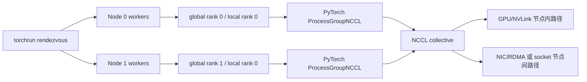
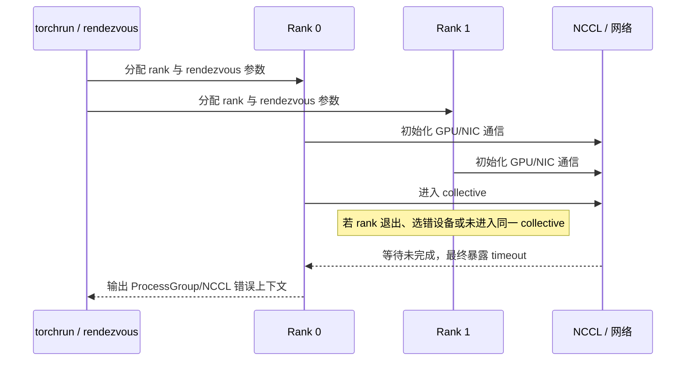
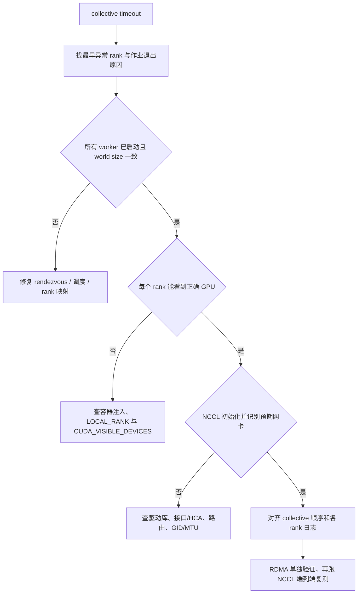

# 第 8 章：NCCL、MPI 与 PyTorch 多节点通信

## 学习目标与岗位场景

本章以 PyTorch Distributed 的多机 collective smoke test 为主线，解释 rank/world size、ProcessGroup、torchrun、MPI 启动器与 NCCL 通信的职责。读者应能区分 rendezvous 未完成、rank 启动不全、NCCL 初始化失败和 collective 执行卡住；能将日志与节点、GPU、NIC/RDMA 路径和任务时间线关联起来。

前置知识：CUDA、Linux 网络、基本 Python/PyTorch，以及第 7 章的 RDMA 概念。实验必须在两台专用 GPU 实验节点进行，并使用隔离端口、测试账号与实验网络；不能在生产作业节点上运行。

## 进程、rank 与 collective

PyTorch Distributed 提供进程组和通信后端抽象。NCCL 是 NVIDIA GPU collective 通信库，常用于 PyTorch 的 NCCL ProcessGroup；MPI 是并行编程/进程启动生态的一部分，可用于启动训练进程或由其他框架调用。`torchrun` 管理本地 worker 并配置 rendezvous 环境；它不是 NCCL，也不提供网络性能保证。

多进程作业中，global rank 在整个作业中唯一，local rank 表示节点内 worker 序号，world size 是参与的总进程数。通常每个 worker 绑定一个 GPU；映射策略要和容器可见设备、`CUDA_VISIBLE_DEVICES`、拓扑及框架设置一致。所有 rank 必须走一致的初始化、collective 顺序与数据形状；任何 rank 在 collective 前退出，都可能让其他 rank 表现为等待或 timeout。



图 8-1：torchrun、PyTorch ProcessGroup 与 NCCL 的关系。实际进程到 GPU/NIC 的映射需按集群拓扑和容器设备映射验证。

常见 collective 包括 AllReduce（聚合并返回给所有参与者）、AllGather（收集各 rank 的数据）、ReduceScatter（聚合后分片）和 Broadcast（从源 rank 广播）。Ring/Tree 是通信算法或拓扑选择的一部分；具体选择由 NCCL 根据设备、消息和配置决定，不能从一条日志推断最佳算法。训练吞吐还受计算/通信重叠、数据管道、消息大小、PCIe/NVLink 和网络竞争影响。

## NCCL timeout 分层定位

先问作业是否完整启动，再看第一个出错的 rank，而不是只看最终 watchdog traceback。分清 rendezvous timeout（进程未会合）、ProcessGroup 初始化问题、NCCL 建链失败和 collective 未完成。检查各节点的作业/容器 ID、rank/world size、GPU 可见性、设备到 rank 的映射、环境变量、节点间端口连通、NCCL 选中的网卡/HCA、驱动/CUDA/NCCL 版本及同一时间的 RDMA 计数器。



图 8-2：rank 不一致如何表现为其他进程等待。超时栈常显示失败暴露点，根因可能更早出现在另一个 rank 或启动阶段。

定位顺序：

1. 收集所有 rank 的原始日志和时间戳，找最早的异常；核对 `RANK`、`LOCAL_RANK`、`WORLD_SIZE`、节点列表、GPU 数和进程退出码。
2. 先确认每个 rank 能初始化正确 GPU，且 world size/collective 调用路径一致；检查作业是否被 OOM、调度器、节点驱逐或用户代码提前终止。
3. 用 `NCCL_DEBUG=INFO` 收集初始化信息；必要时在受控复现开启更详细调试输出。调试变量会增加日志量，不应长期作为全局生产设置。
4. 若建链失败，核对接口选择、路由/防火墙、HCA、GID、MTU、容器设备权限和 NCCL 拓扑；检查 NCCL 实际检测到的网络，而不是只猜环境变量。
5. 用第 7 章的隔离 RDMA 测试验证底层路径，再用 NCCL tests 或代表性训练验证 collective。单机测试成功不能证明跨机链路正常。
6. 在找到根因前不要仅靠调大 timeout 隐藏慢 rank、网络丢包或应用死锁。复测时固定变量、拓扑与输入，记录变更并能回滚。



图 8-3：NCCL timeout 的证据驱动诊断树。优先检查 rank 和第一条错误，避免把最终 timeout 当作根因。

## 实验：两节点 PyTorch NCCL AllReduce 烟雾测试

**实验状态：需目标环境验证。** 当前没有可确认的双节点 GPU/RDMA 集群。本实验会占用两张实验 GPU 和网络；只可在隔离双节点环境运行。它验证基本进程组/rendezvous/collective，不是 NCCL 性能基准或完整训练验证。

**前提：** 两台 Linux 实验节点，各有一张可分配 GPU；PyTorch CUDA build、NVIDIA Driver、NCCL 与 GPU 架构兼容；相同脚本在两端可读；实验网卡路由可达；TCP rendezvous 端口 `29500` 在两节点间允许。实验用户有权使用 GPU。先在两节点确认 Python 环境：

```bash
python -c 'import torch; print(torch.__version__, torch.cuda.is_available(), torch.cuda.device_count())'
torchrun --help >/dev/null
```

**步骤：** 在两节点各自的 Bash 终端生成独立的私有临时目录；两边目录路径可以不同。保持该终端打开，稍后在此路径保存同一份脚本源码：

```bash
umask 077
NCCL_WORKDIR="$(mktemp -d "${TMPDIR:-/tmp}/nccl-smoke.XXXXXX")"
NCCL_SCRIPT="$NCCL_WORKDIR/nccl_smoke.py"
echo "script path: $NCCL_SCRIPT"
```

将下面完全相同的 Python 源码分别保存到两节点各自的 `$NCCL_SCRIPT`。不要覆盖固定的 `/tmp` 文件或使用另一项实验的目录。

```bash
cat > "$NCCL_SCRIPT" <<'PY'
import datetime
import os

import torch
import torch.distributed as dist

rank = int(os.environ["RANK"])
local_rank = int(os.environ["LOCAL_RANK"])
world_size = int(os.environ["WORLD_SIZE"])

if world_size != 2:
    raise RuntimeError(f"expected WORLD_SIZE=2, got {world_size}")

torch.cuda.set_device(local_rank)
dist.init_process_group(
    backend="nccl",
    timeout=datetime.timedelta(seconds=120),
)

value = torch.tensor([rank + 1], dtype=torch.int64, device=f"cuda:{local_rank}")
dist.all_reduce(value, op=dist.ReduceOp.SUM)
result = int(value.item())
print(f"rank={rank} local_rank={local_rank} result={result}", flush=True)
if result != 3:
    raise RuntimeError(f"all_reduce mismatch: expected 3, got {result}")

dist.destroy_process_group()
PY
```

先从网络负责人提供的实验网信息中选取节点 A 的 IP，并在 A、B 两端各自设置必填 shell 变量 `MASTER_ADDR` 为该地址；确认 B 可路由到该地址且 `29500` 已获准。分别在保留了各自 `NCCL_SCRIPT` 变量的节点终端运行对应命令，不要把两个节点命令在同一台机器串行执行。两端应使用相同 PyTorch 环境和相同脚本内容。

```bash
# 节点 A
: "${MASTER_ADDR:?Set to Node A experiment IP reachable from Node B}"
: "${NCCL_SCRIPT:?Save the smoke script to the unique path created on this node}"
NCCL_DEBUG=INFO torchrun --nnodes=2 --nproc_per_node=1 --node_rank=0 \
  --master_addr="$MASTER_ADDR" --master_port=29500 \
  "$NCCL_SCRIPT"

# 节点 B
: "${MASTER_ADDR:?Set to Node A experiment IP reachable from Node B}"
: "${NCCL_SCRIPT:?Save the smoke script to the unique path created on this node}"
NCCL_DEBUG=INFO torchrun --nnodes=2 --nproc_per_node=1 --node_rank=1 \
  --master_addr="$MASTER_ADDR" --master_port=29500 \
  "$NCCL_SCRIPT"
```

**预期与验证：** 两边各有一个 rank，最终都打印 `result=3` 并以退出码 0 结束。保存两端完整日志、PyTorch/驱动/NCCL 版本和使用的网络接口。若 timeout，按本章流程检查两端日志及第一条错误；固定测试端口和接口后再复测。smoke test 成功不证明生产拓扑吞吐、容错或大消息性能。

**清理：** 在各节点原终端确认两端进程已退出，再删除本次私有目录中的准确脚本并移除空目录：

```bash
: "${NCCL_WORKDIR:?Use the private directory created for this experiment}"
: "${NCCL_SCRIPT:?Use the script path created for this experiment}"
case "$NCCL_WORKDIR" in
  "${TMPDIR:-/tmp}"/nccl-smoke.*) ;;
  *) echo "Refusing to clean an unexpected working directory: $NCCL_WORKDIR" >&2; exit 2 ;;
esac
if [ "$NCCL_SCRIPT" != "$NCCL_WORKDIR/nccl_smoke.py" ]; then
  echo "Refusing to clean an unexpected script path: $NCCL_SCRIPT" >&2
  exit 2
fi
rm -f "$NCCL_SCRIPT"
rmdir "$NCCL_WORKDIR"
```

若因 timeout 仍有 worker，先确认 PID 属于本实验再终止，不要执行宽泛的 `pkill python`。释放实验 GPU，并确认无遗留测试作业。

## MPI 的使用边界

MPI 实现提供消息传递 API 和启动/进程管理工具，不是 GPU 驱动或 NIC 配置工具。集群可能由 MPI launcher 启动 PyTorch worker，再由 ProcessGroup/NCCL 执行 GPU collectives；也可能用 torchrun 管理 worker。避免混用多个 launcher 导致进程数翻倍。MPI 与 UCX、OFI、HCA 的具体组合取决于集群模块和编译选项，验收需记录二进制版本、transport、环境模块和实际绑定情况。

本章产出：多机训练通信依赖图；按“启动、rank、GPU、NCCL 初始化、网络、collective、应用”排列的 timeout 排查树；一次完整的双节点 smoke test 记录。

## 面试题与答案要点

1. **`torchrun`、PyTorch Distributed、NCCL 和 MPI 各负责什么？** torchrun 启动/协调 worker；Distributed 提供进程组抽象；NCCL 执行 GPU collective；MPI 是消息传递生态及可选启动/通信方案。
2. **global rank、local rank、world size 分别是什么？** 全局进程序号、节点内序号、作业参与进程总数；必须和设备映射一致。
3. **一个 rank 挂掉，其他 rank 为什么会 timeout？** 其他 rank 可能进入需要所有参与者的 collective，缺少参与者就无法完成。
4. **日志中的 timeout 栈一定指向根因吗？** 不一定；它可能只是 watchdog 发现等待超时，需找全体 rank 中最早错误。
5. **如何区分 rendezvous 与 NCCL collective timeout？** 看异常阶段、rank 是否都建立进程组、NCCL 初始化日志和 collective 开始记录。
6. **单机 AllReduce 通过能证明多机网络正常吗？** 不能；单机可能走 NVLink/PCIe 路径，需要跨机 verbs 与 NCCL 测试。
7. **为什么不能先把 timeout 大幅调高？** 可能隐藏死锁、慢 rank 或网络故障，延迟失败并占用资源；先定位根因。
8. **`NCCL_DEBUG=INFO` 有什么用途和代价？** 展示初始化/网络选择等信息，帮助定位；会增加日志量，需短期按作业设置。
9. **NCCL 没选预期 HCA 时应检查什么？** 实际接口/HCA 可见性、容器权限、路由、GID/MTU、驱动库、NCCL 拓扑与环境变量。
10. **AllReduce smoke test 结果正确能说明什么？** 基本 rendezvous、GPU 设备、进程组和一次 collective 通路可用；不表示性能、长时稳定或完整训练已验收。

## 官方资料

- PyTorch Distributed：<https://docs.pytorch.org/docs/stable/distributed.html>
- PyTorch torchrun / Elastic Launch：<https://docs.pytorch.org/docs/stable/elastic/run.html>
- NVIDIA NCCL User Guide：<https://docs.nvidia.com/deeplearning/nccl/user-guide/docs/index.html>
- NVIDIA NCCL Troubleshooting：<https://docs.nvidia.com/deeplearning/nccl/user-guide/docs/troubleshooting.html>
- Open MPI Documentation：<https://docs.open-mpi.org/en/v5.0.x/>

文档整理日期：2026-10-06。torchrun 参数、timeout、NCCL 调试变量和 MPI transport 按目标 PyTorch/NCCL/MPI 发行版文档验证。
