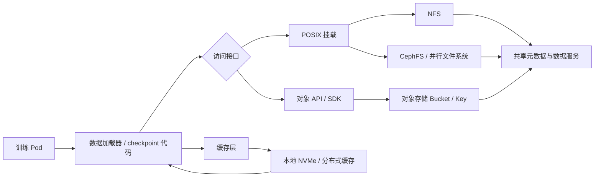
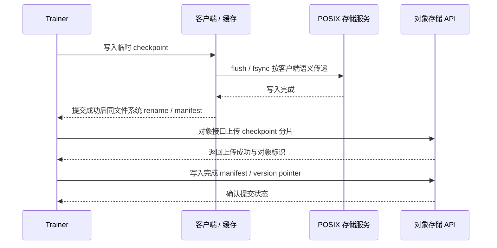
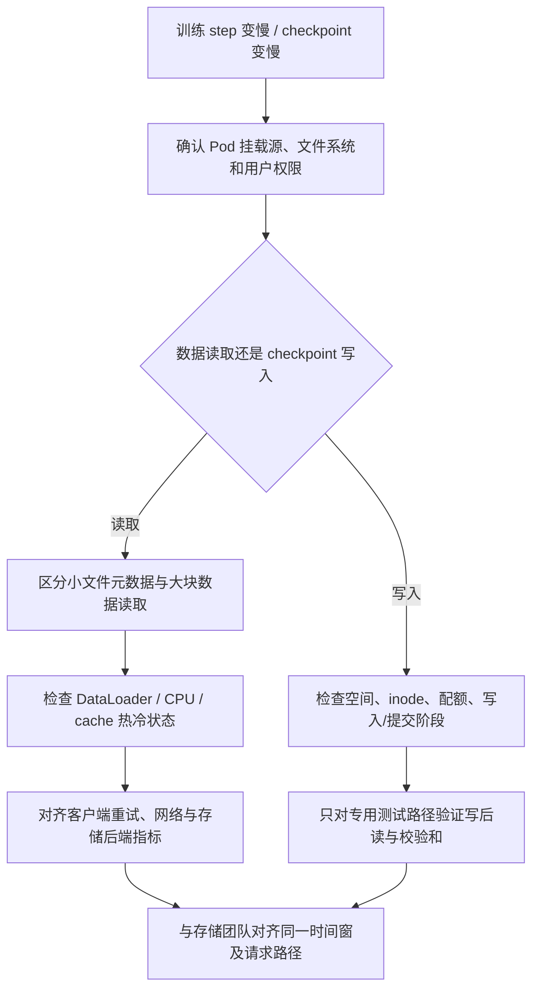

# 第 9 章：训练存储、缓存与数据管道

## 学习目标与岗位场景

本章聚焦训练输入、共享挂载和 checkpoint 路径。完成后，应能按访问语义、元数据压力、吞吐/延迟需求、并发规模、故障域和恢复目标比较 NFS、CephFS、并行文件系统（PFS）、对象存储与缓存；能检查挂载和容器权限，判断数据加载慢、checkpoint 慢或节点故障是客户端、网络、存储服务还是训练流程的问题。

## 存储接口与训练工作负载

NFS 提供网络文件系统语义，常用于共享 POSIX 路径；实际扩展性和行为取决于版本、客户端/服务端配置、网络与后端。CephFS 是 Ceph 提供的分布式 POSIX 文件系统；并行文件系统（如 Lustre、BeeGFS 等）常用于 HPC 高并发工作负载，但需要理解厂商/项目的客户端、元数据服务和运维要求。对象存储以 bucket/key/object 为核心接口，适合大对象和数据湖式访问，但不是普通 POSIX 文件系统；若通过 FUSE 适配挂载，其缓存、重命名和一致性语义仍需核实。缓存可以是节点本地 NVMe、分布式缓存或应用数据集缓存，必须考虑冷启动、淘汰、校验、失效与数据版本。

Kubernetes PVC/PV/CSI 负责将存储资源呈现给工作负载的一部分生命周期，不能替代后端性能和数据保护设计。训练通常混合多种访问：小文件元数据扫描、大批顺序读取、随机样本读取、模型/优化器 checkpoint 写入与恢复。需将“吞吐”与“元数据操作率”“单文件尾延迟”“并发数”“故障恢复时间”分开测量。



图 9-1：训练数据路径的不同访问接口。对象 API 与 POSIX 文件系统不是等价接口；缓存需要处理数据版本和失效。

## 按负载选择与验收

先描述数据集和训练行为，再选系统：文件数与平均大小、目录深度、每 rank 并发、打开/关闭频率、顺序/随机读、是否频繁 rename、checkpoint 大小/频率、恢复 RTO/RPO、区域/故障域和权限要求。用代表性样本测量而非空文件或单客户端测速。NFS 的单文件锁/缓存等语义和挂载参数必须按服务器版本核对；CephFS/PFS 需了解元数据服务及客户端版本；对象存储需确认 API 限流、请求成本、分片上传、对象版本和访问授权。不同厂商兼容 S3 API 的行为并不完全相同。

检查路径依次包括：

- **挂载：** 先设置一个已知位于获批训练挂载上的路径，再核对文件系统类型、挂载源和容量。目录存在但目标挂载没挂上时，路径可能实际落到节点本地盘，因此不能只看 `df` 的剩余空间。`mountpoint` 只在路径本身应为挂载点时使用；若检查的是挂载内子目录，以 `findmnt -T` 显示的实际 mount target 为准。

  ```bash
  : "${TRAINING_PATH:?Set to a known path on the approved training mount}"
  findmnt -T "$TRAINING_PATH"
  mountpoint "$TRAINING_PATH"
  df -hT "$TRAINING_PATH"
  ```
- **容量与 inode：** 看空间、inode、配额和后端水位；剩余容量充足不代表小文件创建成功。
- **权限与身份：** 核对 UID/GID、补充组、ACL、root-squash/映射策略、容器 SecurityContext 和服务端授权；避免用 root 写入“验证”来掩盖用户权限错误。
- **健康与时延：** 对齐客户端内核日志、CSI/Pod 事件、存储客户端状态和后端告警；检查重传、重连、元数据延迟及同一时间的多作业影响。
- **数据正确性：** checkpoint 写入需有完成标记/manifest、大小和校验和；读回验证应使用副本/测试对象，避免覆盖真实训练 checkpoint。

checkpoint 策略通常要满足：临时文件写完后再提交，确保同一文件系统上 rename 的适用语义；对象存储需使用完整对象键、版本/manifest 或完成标记来识别已提交状态。容错实现依赖框架和存储语义，不能假设不同文件系统都提供相同的原子性、缓存一致性或耐久保证。必须结合 PyTorch/训练框架的恢复流程实际验证。



图 9-2：POSIX 文件 checkpoint 与对象存储提交模式的概念差异。flush/rename/manifest 的保证必须由目标后端文档和故障测试确认。

数据输入变慢时，需要拆开“容器内数据等待”与 GPU 计算时间：检查 DataLoader worker、CPU/NUMA、页缓存、文件打开/小文件扫描、挂载重试、客户端队列、网络与后端时延，并用相同数据集对比热缓存/冷缓存。缓存命中率上升可能降低后端流量但不能证明数据新鲜；每条训练样本的版本和数据集快照需可追溯。



图 9-3：存储慢问题的分流。需要从工作负载指标落到具体路径、客户端和后端证据，避免只凭 GPU 利用率判因。

## 实验：隔离 POSIX 挂载上的小型 checkpoint 写后读

**实验状态：需目标环境验证。** 当前机器未发现可确认的 NFS/Ceph/PFS 实验挂载。本实验仅可在专用实验节点或隔离 Kubernetes Pod 中、专用 scratch 挂载上执行；严禁设置为生产数据目录、用户 home、真实训练目录或根目录。写入量固定为 8 MiB，不是性能基准。

**前提：** 由存储负责人提供一个挂载点本身就是专用隔离 POSIX scratch 的路径，例如 `/mnt/storage-lab/scratch`；确认该路径确实属于测试后端。需要 Python 3.7 或更新版本以及 `findmnt`。在同一 Bash 终端显式将 `TEST_ROOT` 设置为获批路径，例如 `export TEST_ROOT=/mnt/storage-lab/scratch`，然后检查挂载：

```bash
: "${TEST_ROOT:?Set to the approved scratch mountpoint}"
findmnt --target "$TEST_ROOT"
df -hT "$TEST_ROOT"
```

若 `findmnt` 的 mount target 不是 `$TEST_ROOT`，或显示的不是预期实验文件系统，停止，不要继续写入。脚本开始写入前也会重新核对 mount target，避免只依赖较早的检查结果。

**步骤：** 在隔离节点运行以下脚本。它创建随机唯一的临时目录，写入 8 MiB 数据，以 SHA-256 校验写后读一致性，并在正常结束时自动删除测试目录。

```bash
python3 - "$TEST_ROOT" <<'PY'
import hashlib
import os
import secrets
import subprocess
import sys
import tempfile
import time
from pathlib import Path

root = Path(sys.argv[1]).resolve(strict=True)
if root == Path("/") or root == Path.home():
    raise SystemExit(f"refusing unsafe test root: {root}")
mount = subprocess.run(
    ["findmnt", "--noheadings", "--output", "TARGET", "--target", str(root)],
    check=True,
    capture_output=True,
    text=True,
)
mounted_target = Path(mount.stdout.strip()).resolve(strict=True)
if mounted_target != root:
    raise SystemExit(f"refusing to write: {root} is not the confirmed scratch mount target")

payload = secrets.token_bytes(8 * 1024 * 1024)
expected = hashlib.sha256(payload).hexdigest()
with tempfile.TemporaryDirectory(prefix="ch09-checkpoint-", dir=root) as workdir:
    tmp = Path(workdir) / "checkpoint.part"
    final = Path(workdir) / "checkpoint.bin"
    started = time.monotonic()
    with tmp.open("wb") as stream:
        stream.write(payload)
        stream.flush()
        os.fsync(stream.fileno())
    os.replace(tmp, final)
    write_seconds = time.monotonic() - started

    started = time.monotonic()
    actual = hashlib.sha256(final.read_bytes()).hexdigest()
    read_seconds = time.monotonic() - started
    if actual != expected:
        raise SystemExit("checksum mismatch")
    print(f"bytes={len(payload)} sha256={actual}")
    print(f"write_seconds={write_seconds:.6f} read_seconds={read_seconds:.6f}")
PY
```

**预期与验证：** 输出 8 MiB 字节数且 SHA-256 一致，命令退出码为 0；脚本结束后再次运行 `findmnt --target "$TEST_ROOT"`，确认目标仍是该 scratch 挂载点，并将 `SOURCE` 与写入前输出对照。记录时间只用于确认流程完成，不作为系统性能承诺。该测试证明一条 POSIX 写入/读取路径可用，不证明崩溃一致性、后端耐久性或生产 checkpoint 恢复正确。

**清理：** Python 正常结束时 `TemporaryDirectory` 自动清理。若进程被强制终止，先确认测试挂载源，再只删除本实验生成的 `ch09-checkpoint-*` 目录；不得对共享目录执行宽泛 `rm -rf`。生产 checkpoint 与数据集不应出现在该测试路径。

## 可选对象存储验证

对象存储不能用 POSIX rename 实验代替。只有当平台提供专用实验 bucket、最小权限账号和已核准 endpoint 时，才用该供应商官方 SDK/CLI 对唯一测试 key 执行 Put、Head、Get、校验和、Delete；key 前缀限定为本次实验 ID。先验证访问策略和 endpoint，再按对象版本、multipart 和完成 manifest 语义设计清理。不要把通用 S3 兼容性推断为对象锁、强一致、rename 或耐久策略完全相同。

## 本章产出

- 一份至少覆盖两种候选后端的访问语义/元数据/吞吐/恢复需求对比表。
- 一份挂载巡检与数据加载故障模板，包含 mount source、UID/GID、容量/inode、客户端日志和后端指标。
- 一份 checkpoint 写入/恢复测试方案，区分文件系统与对象存储语义，记录数据校验及故障窗口。

## 面试题与答案要点

1. **NFS、CephFS/PFS 与对象存储的接口差异是什么？** 前几者通常提供文件系统语义；对象存储以 API 和对象键访问，不能直接假设完整 POSIX 行为。
2. **Pod 中目录存在，如何确认真实挂载成功？** 用 `findmnt -T`/`mountpoint` 对照 mount source、文件系统类型和预期后端，并检查 Pod Volume/PVC 状态。
3. **GPU 利用率低能说明存储是瓶颈吗？** 不能；还要看 DataLoader、CPU、同步等待、网络和训练阶段指标。
4. **怎样区分数据加载慢的元数据瓶颈与大块吞吐瓶颈？** 观察文件数量/打开操作、目录扫描时延与大块读吞吐，使用代表性数据集和并发模式测量。
5. **为什么要同时看容量和 inode？** 文件系统可能还有字节空间但 inode 已耗尽，导致小文件创建失败。
6. **客户端挂载可写是否代表训练账号有正确权限？** 不一定；必须以实际容器 UID/GID、ACL、root-squash/身份映射验证。
7. **为什么不能把对象存储当作普通 POSIX 盘？** API 语义不同；rename、追加写、锁、目录和缓存行为可能由适配层模拟且有不同保证。
8. **checkpoint 如何避免读取到半成品？** 使用临时对象/文件、提交标记或 manifest，完成后按后端支持的原子提交语义发布，并验证框架恢复路径。
9. **缓存命中率高意味着数据正确吗？** 不意味着；还需版本标识、失效策略、校验和及快照一致性。
10. **存储端报错时平台团队要提供哪些证据？** Pod/节点/挂载源、用户身份、时间窗、文件路径类别、客户端重试/内核日志、读写阶段和后端关联指标。

## 官方资料

- Linux Kernel NFS Documentation：<https://docs.kernel.org/filesystems/nfs/index.html>
- CephFS Documentation：<https://docs.ceph.com/en/latest/cephfs/>
- Lustre Documentation Wiki：<https://wiki.lustre.org/Main_Page>
- BeeGFS Documentation：<https://doc.beegfs.io/latest/>
- Kubernetes Volumes：<https://kubernetes.io/docs/concepts/storage/volumes/>
- AWS Amazon S3 User Guide：<https://docs.aws.amazon.com/AmazonS3/latest/userguide/Welcome.html>
- PyTorch Saving and Loading Models：<https://docs.pytorch.org/tutorials/beginner/saving_loading_models.html>

文档整理日期：2026-10-06。存储客户端/服务端版本、CSI 驱动、对象存储兼容行为和一致性承诺以目标供应商对应版本文档与验收记录为准。
