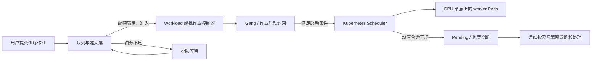
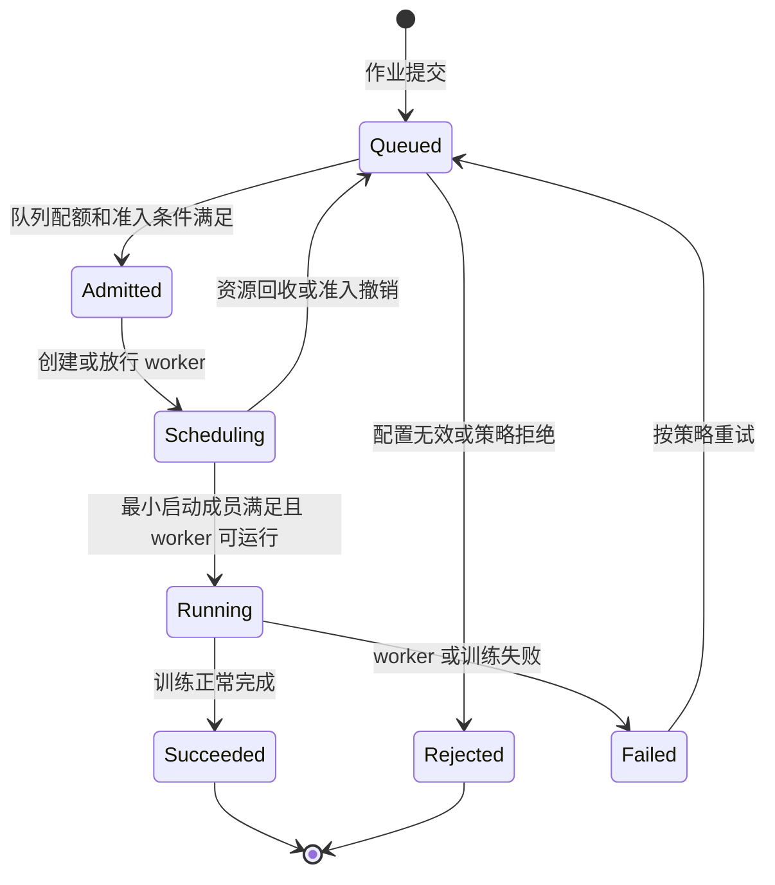
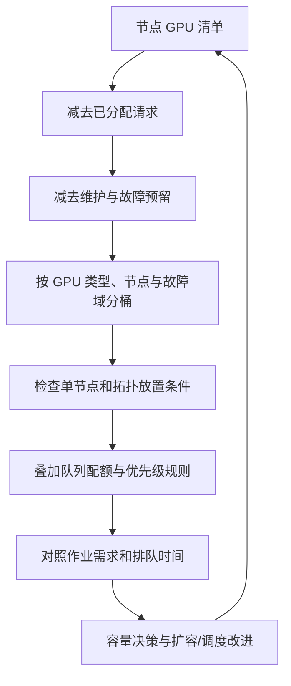

# 第 10 章：训练作业调度与 GPU 容量规划

## 学习目标与岗位场景

本章聚焦作业为什么排队、为什么有空闲 GPU 却放不进去、队列规则如何影响训练吞吐。完成本章后，读者应能区分 Kubernetes 资源调度与批处理作业准入，解释 gang 调度的收益和代价，读懂队列与配额的基本账本，并用可复核的数据估算 GPU 容量。

调度器只能基于已声明且可观察的资源做决定。GPU 利用率高不等于调度容量紧张，利用率低也不一定代表可以安全超卖；显存、互联拓扑、CPU、内存、网络、存储和作业并行策略都会影响有效容量。Volcano、Kueue、Kubernetes Scheduler 的职责和配置模型不同，不应把它们的术语直接互换。部署前须按所用版本核对官方文档及集群中实际启用的插件。

## 10.1 从 Pod 调度到作业准入

Kubernetes Scheduler 为单个 Pod 选择节点。分布式训练往往由多个 worker Pod 组成：如果只调度其中一部分，其余 Pod 长时间 Pending，已经占用的 GPU 也无法形成可用训练作业。Gang Scheduling 的核心是让一组关联的 Pod 满足最小启动条件后再整体推进；具体的最小成员数、等待行为和抢占语义取决于调度方案与配置。

Kueue 主要负责作业准入和资源配额治理：队列中的 Workload 获得准入后，底层 Kubernetes 调度器仍负责将 Pod 放到节点。ClusterQueue、LocalQueue、ResourceFlavor、借用和抢占等概念需要按 Kueue 版本理解。Volcano 提供面向批处理的调度能力，包括队列、作业和 gang 等机制；其具体插件链与策略由集群部署决定。两者可以解决相近的批任务问题，但 API 和控制流程不同。

**图 10-1：批作业从提交、准入到 Pod 落点的职责链。**



Pod Pending 常见原因可以粗分为：资源数量不足、单节点无法容纳、拓扑约束不满足、污点与容忍不匹配、亲和性约束过严、镜像或控制器问题。不能仅凭“集群还有 N 张空闲卡”推断作业能启动；应同时检查每个节点可分配资源、节点标签、设备类型、Pod 请求、配额及作业的最小启动条件。

## 10.2 Gang、队列、配额与公平性

Gang 机制适合启动成员之间强依赖的分布式作业。它能避免只启动部分 worker 后持续占住资源，却可能让小作业等待更久，也可能因较大的启动门槛降低短期利用率。应明确作业的最小可运行规模、等待时限、优先级、公平策略和失败释放规则。不要把“全部 worker 同时被放置”当成所有实现都提供的同一语义；要查该版本对 admission、scheduling、preemption 和重试的定义。

队列提供组织和隔离边界。配额表达可用资源的账面上限或准入资源池；借用、回收、优先级和抢占规则决定不同团队如何共享空闲容量。Kubernetes ResourceQuota 是命名空间范围的对象资源约束；Kueue 的队列配额与其准入模型不同。平台需说明这两层如何组合，避免一层允许而另一层拒绝，或账面总和超过可兑现容量。

**图 10-2：Gang 作业的抽象状态流。状态名仅用于解释，实际对象状态以已部署实现为准。**



队列策略要同时考虑吞吐与等待体验。面向交互调试、短作业、长时间训练和高优先级保障任务，可以使用不同队列或优先级，但每个优先级都应有可解释的准入条件、预算和审计记录。抢占会中断受害作业，需结合 checkpoint 能力、重启成本、PodDisruptionBudget 的适用范围及业务优先级评估。配额不是物理容量的替代品，不能仅靠提高配额解决排队。

## 10.3 GPU 容量与碎片

容量盘点从节点的 Allocatable、GPU 资源类型、已分配请求、维护预留和故障余量开始。对整卡资源，单节点可放置性经常比集群总量更重要；例如空闲卡散落在多个节点上，仍可能无法满足有大块单节点需求的作业。多节点作业还会受到网络拓扑、交换机分区、存储带宽和调度策略限制。若使用 MIG 或共享型 GPU，账本必须按实际暴露给调度器的资源类型统计，并单独记录显存和隔离语义，不能把切分实例简单换算成任意数量的整卡。

一个可审计的容量表至少包含：节点池与故障域、节点数、每节点可分配 GPU 类型和数量、已请求量、不可用/维护预留量、队列配额、作业需求分布、排队时长、取消/抢占情况、训练并行拓扑约束和计划增长量。预测时使用历史作业到达与持续时间分布，而不是只取某一时刻的 GPU 利用率。容量方案要显式列出故障或维护时的降级目标，例如可接受的排队时间、可保障队列以及可暂停任务。

**图 10-3：GPU 容量核算从总量推进到可放置性。**



## 10.4 实践：离线计算整卡 GPU 碎片

这项练习只模拟资源账本，不连接 Kubernetes，也不证明任何调度器的实际行为。它展示“总空闲卡数足够，但单节点无法放入请求”的区别。

**前提：** 本地 Python 3.6 或更新版本；无需 GPU、集群权限或第三方依赖。练习假设 GPU 只能按整卡分配，单个 job 的请求必须放在一个节点，按节点顺序 first-fit。它不模拟 gang、多资源、拓扑或抢占。

**步骤：** 在终端运行以下脚本：

```python
free = [2, 6]  # node-1、node-2 的空闲整卡数
jobs = [("large", 4), ("next", 4), ("small", 2)]

for name, need in jobs:
    candidates = [i for i, available in enumerate(free) if available >= need]
    if candidates:
        node = candidates[0]
        free[node] -= need
        print(f"{name}: FIT node-{node + 1}; free={free}")
    elif sum(free) >= need:
        print(f"{name}: FRAGMENTED; aggregate={sum(free)}, need={need}; free={free}")
    else:
        print(f"{name}: CAPACITY_SHORT; aggregate={sum(free)}, need={need}; free={free}")
```

**预期结果：**

```text
large: FIT node-2; free=[2, 2]
next: FRAGMENTED; aggregate=4, need=4; free=[2, 2]
small: FIT node-1; free=[0, 2]
```

**验证方法：** 检查第一项放置后两个节点各剩 2 卡，因此第二项虽然集群总空闲量为 4，却不存在单节点可容纳 4 卡；最后一个 2 卡作业仍可放入 node-1。可改变节点空闲量或 job 顺序，观察 first-fit 的结果如何变化。

**清理：** 脚本只在进程内修改列表，不创建文件、不访问集群；进程结束即清理。

## 本章产出与验收

提交一份 GPU 容量表、队列和优先级草案，以及一张排队故障诊断记录。验收时应能区分准入失败与 Pod 放置失败，解释 gang 门槛对等待和资源占用的影响，并用逐节点账本证明可放置性。离线练习只验证算术模型；Volcano/Kueue 配置和真实多节点 gang 行为需目标环境验证。

## 章末面试题

1. **Kueue 准入和 Kubernetes Scheduler 分别解决什么问题？**  
   要点：Kueue 管理 Workload 队列、配额和准入；准入后由调度链路为 Pod 选节点，具体集成依版本和配置。
2. **Gang Scheduling 为什么有用？代价是什么？**  
   要点：减少部分 worker 长期占资源；较大的启动门槛会增加等待，且具体语义取决于实现。
3. **集群总空闲 GPU 足够，作业仍 Pending，可能是什么原因？**  
   要点：单节点碎片、资源类型不匹配、拓扑/亲和性/污点约束、配额或队列准入。
4. **Kubernetes ResourceQuota 与队列配额能否视为同一机制？**  
   要点：不能；作用范围和准入/执行模型不同，需核对组合关系。
5. **何时使用抢占？**  
   要点：高优先级目标、受害任务可恢复、影响可接受且规则透明时；要度量重启与 checkpoint 成本。
6. **GPU 利用率低，是否足以要求缩减容量？**  
   要点：不足；应结合分配率、等待、作业阶段、显存、数据供给和拓扑约束分析。
7. **如何估算维护期间的容量？**  
   要点：从可分配池扣除维护和故障余量，按节点与故障域重算可放置作业及服务目标。
8. **队列配额合计为什么可能大于物理 GPU 数？**  
   要点：可能使用借用/超额承诺或共享策略；需区分账面上限与同时可兑现量。
9. **作业要求跨节点带宽，调度器只看 GPU 数会有什么风险？**  
   要点：worker 可能落在网络拓扑不合适的位置，导致通信瓶颈；需用可表达的拓扑标签/约束并验证。
10. **上线新的调度策略前要收集什么证据？**  
   要点：代表性作业分布、排队与利用率基线、抢占/重试成本、故障域、回滚方案和目标版本语义。

## 官方资料

- Kubernetes 调度与驱逐概念：<https://kubernetes.io/docs/concepts/scheduling-eviction/>
- Kubernetes ResourceQuota：<https://kubernetes.io/docs/concepts/policy/resource-quotas/>
- Kueue 概览：<https://kueue.sigs.k8s.io/docs/overview/>
- Kueue ClusterQueue：<https://kueue.sigs.k8s.io/docs/concepts/cluster_queue/>
- Kueue Workload：<https://kueue.sigs.k8s.io/docs/concepts/workload/>
- Volcano 文档入口：<https://volcano.sh/en/docs/>

以上链接是官方文档入口；不要据此推定任一当前发行版的插件默认值或兼容矩阵。
