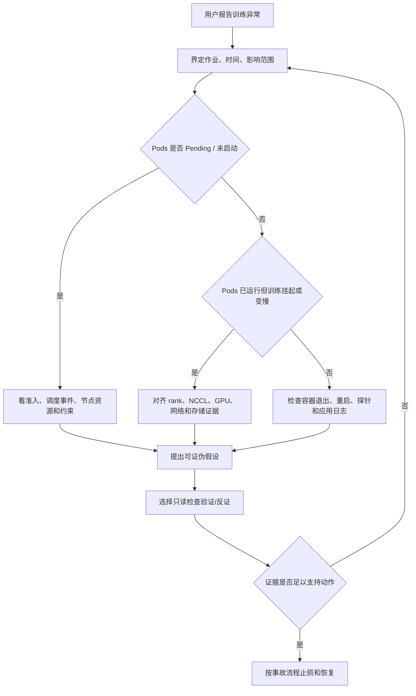
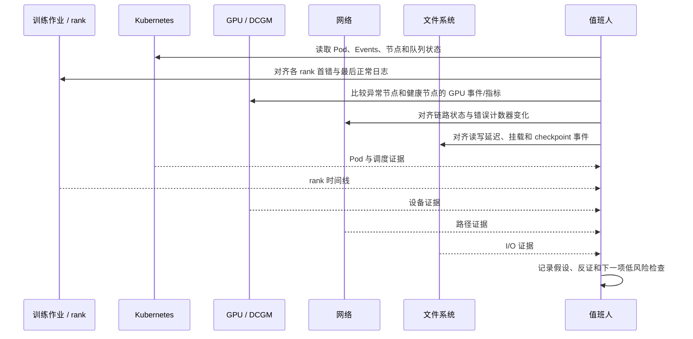
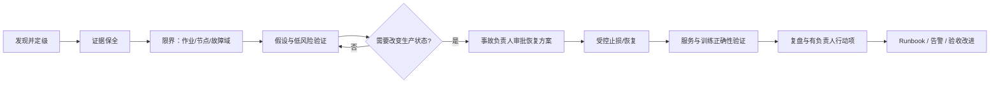

# 第 11 章：分布式训练生产故障诊断

## 学习目标与岗位场景

本章建立一个跨 Kubernetes、GPU、网络、存储和训练框架的诊断闭环。目标不是看到某条日志就猜根因，而是从症状定义范围，保全时间线和证据，提出可证伪假设，选择低风险检查，再决定止损、恢复和升级协作。

生产排障先回答三个问题：哪些作业和节点受影响？故障何时开始、是否对应变更？当前最安全的限制影响面的动作是什么？重启、重建 Pod、清理缓存或修改网络可能抹掉证据并扩大故障，不应作为默认第一步。值班人应遵循组织的权限、事故等级和变更流程。

## 11.1 建立证据链

一次故障记录至少包含：统一时区的开始/结束时间；作业 ID、namespace、queue、worker/rank 到 Pod/节点的映射；首个异常与最后正常时间；影响范围；近期变更；采集命令、原始输出和操作者；假设及其支持/反证；恢复动作与验证结果。保存日志时注意访问控制和脱敏，避免复制凭证、用户数据或完整环境变量。

时间线要把训练日志中的 rank、容器时间戳、节点系统日志、Prometheus 指标、Kubernetes Events 和网络/存储告警对齐。事件可能过期或被聚合；没有事件不代表没有故障。优先比较故障节点与同作业健康节点、故障作业与同节点健康作业，这种对照通常比继续扩大采集范围更有信息量。

**图 11-1：症状驱动的第一轮故障分流。**



## 11.2 常见故障域和证据

**排队或 Pending：** 检查 Workload/队列状态、Pod Events、request/limit、节点 Allocatable、污点、亲和性、资源类型、拓扑约束和准入配额。区分“尚未准入”与“已准入但没有节点能放置”。不能通过删除 Pod 来修复队列配额或容量问题。

**worker 退出或反复重启：** 检查 Pod 状态、容器退出码、重启次数、探针事件、镜像拉取状态、节点 kubelet/container runtime 日志及应用首个错误。退出码通常只是线索，必须结合 stderr/stdout 和节点日志。

**NCCL timeout、挂起或吞吐下降：** 对齐所有 rank 的首个不同点，确认进程组成员、world size、节点/GPU 映射、实际选择的网络接口、NCCL 初始化和 collective 日志。再与 HCA/交换机计数器、链路状态、MTU/GID、GPU 拓扑和节点压力关联。NCCL timeout 是症状，不自动等于网络故障，也可能由 rank 提前退出、CPU 调度停顿、存储阻塞或配置差异引起。

**GPU 错误：** 将训练时间与节点 nvidia-smi/NVML、DCGM、内核日志及 NVIDIA Xid/ECC 记录关联。Xid 的含义和处置需对照对应驱动与 GPU 文档；相同 Xid 也不能脱离上下文推断硬件必坏。避免在未评估影响时执行 reset 或重启。

**数据和 checkpoint：** 对比异常 worker 的存储挂载、文件系统客户端告警、读写延迟、吞吐、元数据请求和 checkpoint 时刻。若每个 rank 同时读取大文件，存储瓶颈可能呈现为通信 collective 等待。确认数据管道、缓存和 checkpoint I/O 的先后关系。

**节点异常：** 确认 NotReady、压力条件、驱动/设备发现变化、网络端口、时间同步和近期变更。先明确受影响节点上的其他作业和 PDB/任务恢复策略，再提出隔离方案。

**图 11-2：用对照组把多层证据关联到同一时间线。**



## 11.3 从止损到恢复

恢复是一个受控决策：保存证据；确定故障边界；评估继续运行、暂停提交、切换资源池或重试任务的代价；由有权限的负责人按事故流程批准；执行后验证服务目标与训练正确性。要分别验证 Pod 已恢复、所有 rank 进入预期通信阶段、GPU/网络/存储指标回到基线范围，以及 checkpoint 是否完整。一次恢复成功不代表根因已消除。

复盘要区分直接触发因素、促成条件和检测缺口。行动项应有负责人、期限和可度量验收项，例如补充告警、修复验收门槛、完善节点标签或自动化证据采集。不要把“提高重试次数”当成根因修复。

**图 11-3：故障处理闭环与升级边界。**



## 11.4 实践：只读排障演练

本练习用固定证据卡练习推理；命令部分只在获准的只读 Kubernetes 环境采集当前状态。练习不修改工作负载，不触发 NCCL 压测，也不执行重启或隔离。

**前提：** 有文档工具即可完成桌面推演。若运行命令，需有集群只读凭证、namespace，并将 KUBE_CONTEXT 设置为经核对且获准访问的目标 context；先确认该 context 指向授权目标，再执行后续只读查询。目标集群的 API、权限和日志保留策略需目标环境验证。演练设定：一个 8-rank 作业已创建全部 Pod；训练日志显示 rank 3 的 collective 超时；GPU 未发现同一时间新增 Xid 记录；一台 worker 的 HCA 错误计数器在异常窗口增长；存储指标尚未取证。

**步骤/命令：**

1. 将固定设定写入事件时间线，分别列出事实、假设和未知项。事实不能改写成因果结论。
2. 在获准环境中，仅采集对象状态和日志。先设置已核对的 KUBE_CONTEXT，并从获批作业信息中取得 NAMESPACE、JOB_SELECTOR、TRAINER_CONTAINER 和 LOG_START_TIME（故障窗口开始前的 RFC3339 时间）：

```bash
: "${KUBE_CONTEXT:?Set and verify the approved context name}"
: "${NAMESPACE:?Obtain from approved job information}"
: "${JOB_SELECTOR:?Obtain the approved label selector for this training job}"
: "${TRAINER_CONTAINER:?Obtain from approved job information}"
: "${LOG_START_TIME:?Set an RFC3339 timestamp before the fault window}"
PODS="$(kubectl --context "$KUBE_CONTEXT" get pods -n "$NAMESPACE" -l "$JOB_SELECTOR" -o name)"
: "${PODS:?The approved selector matched no pods; verify job information}"
kubectl --context "$KUBE_CONTEXT" get pods -n "$NAMESPACE" -l "$JOB_SELECTOR" -o wide
kubectl --context "$KUBE_CONTEXT" get events -n "$NAMESPACE" --sort-by=.metadata.creationTimestamp
kubectl --context "$KUBE_CONTEXT" get nodes -o wide
LOG_FAILURE=0
for POD in $PODS; do
  echo "--- $POD ---"
  if ! kubectl --context "$KUBE_CONTEXT" logs -n "$NAMESPACE" "$POD" -c "$TRAINER_CONTAINER" --since-time="$LOG_START_TIME"; then
    LOG_FAILURE=1
    echo "Log collection failed; record this worker as missing evidence." >&2
  fi
done
if [ "$LOG_FAILURE" -ne 0 ]; then
  echo "At least one worker log is missing; do not treat collection as complete." >&2
  exit 1
fi
```

3. 对照 rank -> Pod -> node 映射，记下所有 worker 的首个异常时间；列出下一步要向 GPU、网络、存储团队核实的只读证据。
4. 写一个不含变更动作的恢复提案：证据、预期止损收益、业务影响、批准人、回滚/退出条件和恢复后验收项。

**预期结果：** 应得出“当前证据更支持优先检查特定节点的 RDMA 路径，但仍不足以认定网络为根因”；需要核对计数器增量的时间相关性、交换机端口、相同节点其他作业，以及异常 rank 日志。GPU 事件未增加不能排除 GPU/驱动问题；存储指标缺失仍是未知项。输出应至少包含 2 个待验证假设和 1 条反证。

**验证方法：** 由同伴逐条检查时间戳、映射、事实/推断分离和反证是否存在；若结论直接写成“网络坏了”或建议先重启，则演练不通过。目标集群命令是否可用及权限范围需目标环境验证。

**清理：** 只读命令不改变集群状态；演练记录应存放在获批的事故文档位置并脱敏。无需集群清理。

## 本章产出与验收

交付一份故障时间线和证据矩阵，覆盖 Kubernetes、训练 rank、GPU、网络和存储中的至少四层，并明确哪些数据缺失。验收标准是同一症状能形成多个可证伪假设，按信息增益和风险选择下一检查，恢复过程有批准边界和服务验证。

## 章末面试题

1. **Pod Pending 和训练进程 hang 的排查起点有何不同？**  
   要点：Pending 先看准入、调度和资源约束；运行后 hang 对齐 rank 日志、通信和依赖层证据。
2. **NCCL timeout 是否能直接证明网络故障？**  
   要点：不能；rank 退出、CPU 停顿、存储阻塞和拓扑/配置差异都可能造成超时。
3. **如何区分准入失败和节点放置失败？**  
   要点：读取队列/Workload admission 状态，再检查 Pod scheduler events 和节点条件。
4. **为什么要比较同作业健康节点与异常节点？**  
   要点：减少共同因素，帮助定位差异和高信息量检查；仍需防止相关性当因果。
5. **一个 worker 没有 Xid，能否排除 GPU？**  
   要点：不能；日志覆盖、错误类型和采样窗口可能不足。
6. **日志时间与监控图对不上怎么办？**  
   要点：核对时区、节点时钟、采集延迟和时间戳来源，保留原始时间并显式归一化。
7. **故障时为什么不先重启 worker？**  
   要点：可能丢失证据、扩大影响、产生重复训练或破坏 checkpoint；须先评估并按流程批准。
8. **如何判断异常是节点级还是作业级？**  
   要点：比较同节点其他作业与跨节点同作业，结合节点健康和 rank 映射。
9. **恢复后应验证哪些方面？**  
   要点：对象健康、所有 rank 状态、训练进度/正确性、GPU/网络/存储信号和 checkpoint。
10. **复盘行动项怎样避免流于形式？**  
    要点：每项有负责人、期限、验收证据，并针对检测、预防或恢复能力。

## 官方资料

- Kubernetes 调试应用：<https://kubernetes.io/docs/tasks/debug/debug-application/>
- Kubernetes 调试节点：<https://kubernetes.io/docs/tasks/debug/debug-cluster/>
- Kubernetes Events API：<https://kubernetes.io/docs/reference/kubernetes-api/cluster-resources/event-v1/>
- PyTorch Distributed：<https://pytorch.org/docs/stable/distributed.html>
- NVIDIA NCCL Troubleshooting：<https://docs.nvidia.com/deeplearning/nccl/user-guide/docs/troubleshooting.html>
- NVIDIA Xid Errors：<https://docs.nvidia.com/deploy/xid-errors/index.html>

命令输出会因 Kubernetes 版本、权限、日志保留和集群组件而不同；按实际目标环境验证。
