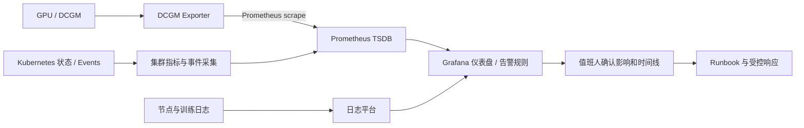
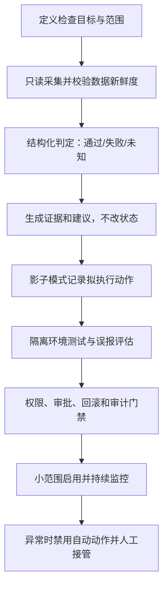
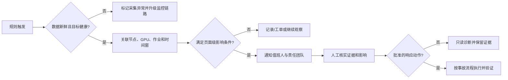

# 第 12 章：可观测性、巡检与运维自动化

## 学习目标与岗位场景

GPU 集群可观测性要回答“哪个资源出了问题、影响哪些训练、证据是否足够触发动作”。本章介绍 DCGM Exporter、Prometheus、Grafana 与 Kubernetes 状态的关系，并给出巡检自动化的工程护栏。目标是做出可重复运行、只读优先、结果可审计的巡检，而不是堆叠仪表盘或把告警直接连到危险操作。

指标、日志、事件和追踪互补。指标适合趋势、阈值和聚合；日志保留具体错误上下文；Kubernetes Events 表达控制器观察到的对象事件；训练日志提供 rank 及框架层状态。采集系统本身也有盲区和延迟，必须显示最后采集时间、目标健康和标签来源。

## 12.1 GPU 指标的采集与使用

DCGM（Data Center GPU Manager）提供 NVIDIA 数据中心 GPU 的管理和监控能力。DCGM Exporter 暴露 Prometheus 可抓取的指标；实际可见字段取决于 exporter、DCGM、驱动、GPU 型号、配置文件和权限。先核对部署文档及 /metrics 输出，不要假设所有节点都暴露相同指标。

平台监控建议按层组织：

- **节点与设备：** GPU 可见性、温度/功耗/时钟、显存、ECC/Xid 相关信号、PCIe/NVLink（若环境支持）。
- **Kubernetes：** 节点条件、Pod Pending/重启、资源请求与分配、设备插件或 Operator 状态。
- **网络与存储：** HCA/接口错误、链路状态、文件系统延迟和错误、数据/检查点路径健康。
- **训练任务：** worker/rank 数量、step 时间、吞吐、通信等待、checkpoint 成功率。

指标要与资产标签关联，如 cluster、node、GPU UUID、作业和队列。注意高基数标签会提高 Prometheus 存储和查询负担；不要将任意用户输入、完整路径或逐请求 ID 无限制作为标签。设备编号可能重排，做节点间比较时应使用稳定的设备标识，并保留采集配置。

**图 12-1：从 GPU 节点到告警和排障上下文的数据链。**



Prometheus 告警应围绕可行动的用户影响或可靠的先兆设计。将告警分为页面级和工单级；设置持续时间、去重、抑制关系和责任人；带上节点、GPU、作业、时间范围和 runbook 链接。单一利用率阈值通常不够：低利用率可能来自数据等待或短作业，高利用率也可能是正常状态。告警规则需要用历史数据回放或影子观察验证误报和漏报。

Grafana 面板要能从集群概览下钻到队列、节点、GPU 和作业，并标明单位、聚合方式、采样窗口、空数据语义和标签筛选。空图既可能表示“没有异常”，也可能表示采集失败；应同时显示 exporter/Prometheus target 的健康状态。

## 12.2 巡检与自动化的工程护栏

巡检先只读采集，再给出明确状态和证据。输出至少包含检查时间、目标范围、工具版本、每项的通过/失败/未知、原始证据引用和建议动作。不能把“命令成功退出”当成“GPU 健康”；也不能把缺少指标当作数值为零。

Shell 适合少量系统命令编排；Python/Go 适合结构化输入输出、API 集成和复杂状态处理；Ansible 适合有清晰 inventory、权限和变更边界的批量配置管理。自动化脚本须处理幂等、超时、重试上限、并发锁、部分失败、审计日志、最小权限和秘密管理。重试不能无限进行，所有超时应有截止时间。

恢复类自动化比巡检风险高。自动隔离节点或重启训练任务前，应验证信号来源、误报影响、故障域、当前作业、PDB/任务 checkpoint 能力和人工升级路径。先通过 shadow mode 记录“将采取的动作”但不执行，再进行有批准的隔离环境演练，最后按照组织发布门禁逐步启用。

**图 12-2：从只读采集到受控自动化的分级路径。**



巡检频率要考虑 API 限流、采集开销和故障发现目标。相同检查应尽可能批量读取、复用缓存并限制并发。对每条自动建议保留输入证据和规则版本，以便事后回答“为什么判定不健康”。

**图 12-3：告警从信号确认到受控响应。**



## 12.3 实践：只读查询 Prometheus 的采集状态

该练习验证 Prometheus HTTP API 可读，并确认查询结果是结构化响应。它不修改 Prometheus，也不保证 DCGM Exporter 已部署。

**前提：** 有权读取的 Prometheus HTTP 地址，已安装 curl 和 jq；如果地址需认证，应使用组织批准的凭证注入方式，勿把 token 写进命令历史。不要通过端口转发连接未授权的生产集群。设置环境变量 PROM_URL，例如隔离实验 Prometheus 的地址 http://127.0.0.1:9090。

**步骤/命令：** 查询 Prometheus 内置的 up 序列：

```bash
: "${PROM_URL:?Set to an approved read-only Prometheus base URL}"
curl --connect-timeout 5 --max-time 20 --fail --silent --show-error --get --data-urlencode 'query=up' "$PROM_URL/api/v1/query" | jq -e '.status == "success" and (.data.result | type == "array")'
```

再查询是否存在 DCGM Exporter 指标；这是 PromQL 元标签选择器，指标名依 exporter 配置而异：

```bash
curl --connect-timeout 5 --max-time 20 --fail --silent --show-error --get --data-urlencode 'query=count by (__name__) ({__name__=~"DCGM_FI_DEV_.*"})' "$PROM_URL/api/v1/query" | jq -e '.status == "success" and (.data.result | type == "array")'
```

**预期结果：** 两条命令在 API 可访问时输出 true。第一条查询的结果数组可能为空，表示当前没有可返回的 up 序列；第二条数组为空可能表示无匹配指标、采集未配置或指标命名不同，不能据此断定 GPU 故障。

**验证方法：** 第一条输出 true 只证明查询 API 返回了成功结构。进一步在 Prometheus Targets 页面或只读 targets API 中确认目标抓取状态；在 Grafana/Prometheus 中查看 exporter 指标时，核对节点标签和采样时间。若实际环境没有 DCGM 指标，记录“未知/未采集”，再按本环境 exporter 配置核实，勿伪造零值。

**清理：** 该练习只发送 GET 查询，不创建规则或时序；取消 PROM_URL 变量或关闭终端即可。若此前使用了本地端口转发，按实验室说明结束该隔离会话。

## 12.4 实践产出与验收

交付一份只读巡检设计，包括范围、数据源、检查规则、失败/未知的表达、权限、超时、输出样例和人工升级条件。若编写脚本，至少在模拟数据上覆盖正常、异常、缺失指标、API 超时和部分失败。当前环境没有已确认可连接的 Prometheus 或 GPU 节点，因此查询命令未实测，需目标环境验证；实际 exporter 指标名、DCGM 支持项及性能开销也需按目标环境核验。

## 章末面试题

1. **DCGM Exporter、Prometheus 和 Grafana 各自职责是什么？**  
   要点：Exporter 暴露指标、Prometheus 采集存储与查询、Grafana 仪表盘/告警呈现；职责可因部署扩展但要明确数据路径。
2. **为什么“没有 GPU 指标”不能解释成“GPU 数值为零”？**  
   要点：可能是未部署、抓取失败、权限/配置问题或标签变化，属于缺失数据。
3. **GPU 利用率适合单独作为自动隔离阈值吗？**  
   要点：通常不适合；需结合持续时间、任务状态、数据供给、设备错误和影响面。
4. **如何避免 Prometheus 标签造成高基数？**  
   要点：限定标签集，避免逐请求/任意字符串标签，对长尾维度使用日志或离线分析。
5. **巡检应如何表示 API 超时？**  
   要点：明确标成未知/采集失败，保留目标和错误，不能标成通过或健康。
6. **幂等对运维自动化有什么意义？**  
   要点：重复运行不会造成状态累积或重复副作用；需处理并发和部分失败。
7. **自动化中的重试应有哪些限制？**  
   要点：有限次数、退避、截止时间、幂等前提、可取消及审计。
8. **如何降低告警风暴？**  
   要点：聚合故障域、去重、抑制从属告警、合理持续时间和路由。
9. **自动隔离节点前要验证哪些方面？**  
   要点：证据可靠性、受影响作业、冗余容量、PDB/恢复能力、授权审批和回滚。
10. **怎样验证新告警的质量？**  
    要点：回放历史、影子观测、误报/漏报统计、行动时间和实际用户影响。

## 官方资料

- NVIDIA DCGM 用户指南：<https://docs.nvidia.com/datacenter/dcgm/latest/user-guide/index.html>
- NVIDIA DCGM Exporter 项目与部署说明：<https://github.com/NVIDIA/dcgm-exporter>
- NVIDIA GPU Operator 文档：<https://docs.nvidia.com/datacenter/cloud-native/gpu-operator/latest/index.html>
- Prometheus 概览：<https://prometheus.io/docs/introduction/overview/>
- Prometheus 查询基础：<https://prometheus.io/docs/prometheus/latest/querying/basics/>
- Prometheus HTTP API：<https://prometheus.io/docs/prometheus/latest/querying/api/>
- Grafana 文档：<https://grafana.com/docs/grafana/latest/>
- Ansible Playbook 入门：<https://docs.ansible.com/ansible/latest/playbook_guide/playbooks_intro.html>

接口字段和 GPU 指标清单应以目标软件版本的官方文档及实际 /metrics 输出为准。
