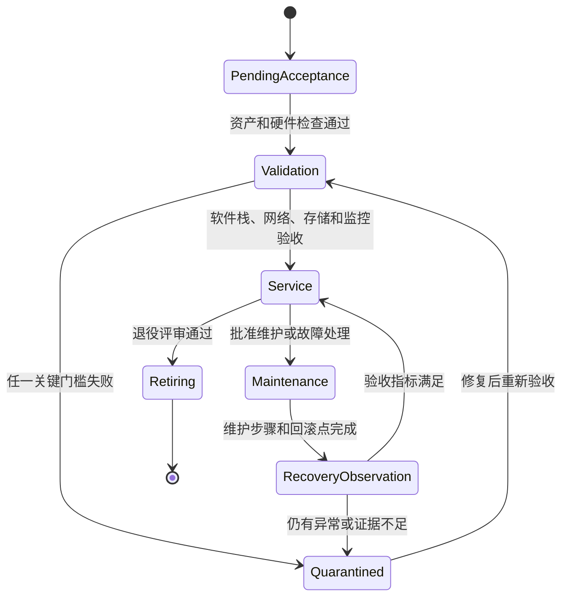
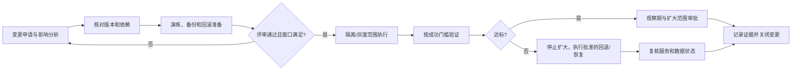
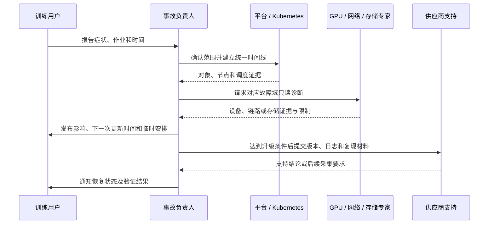

# 第 13 章：生产变更、值班与集群生命周期

## 学习目标与岗位场景

大规模 GPU 集群的运维不仅是节点故障后的修复，也包括从服务器验收、纳管、升级、隔离、恢复到退役的可审计生命周期。驱动、固件、GPU Operator、Kubernetes、网络和存储变更可能相互影响；每次变更都要说明目标、范围、前置条件、验证证据、停止条件、回滚路径和沟通安排。

本章的实验是桌面变更评审演练。生产变更只做方案设计，不提供让读者直接在生产执行的变更命令。任何实际操作都必须由组织授权人员按既有变更与事故流程执行。

## 13.1 节点生命周期

建议将节点生命周期表示为显式状态，状态变更有负责角色和证据：

- **待验收：** 资产、序列号、固件、供电/散热、PCIe/GPU/NIC 拓扑、系统镜像及带外管理信息齐全。
- **验证中：** 在隔离池完成硬件健康、驱动栈、容器 GPU、网络/RDMA、存储挂载、监控和重启恢复验证。
- **可服务：** 节点标签、GPU 资源和故障域信息与实际一致，所有关键检查有结果与时间戳。
- **维护/隔离：** 明确影响作业、允许的维护窗口、数据/任务保护、恢复负责人和退出条件。
- **恢复观察：** 节点重新加入前验证设备、网络、存储、监控和代表性负载；观察期与门槛由服务目标决定。
- **退役：** 排空并核对剩余工作负载和本地数据，撤销凭证/资产关联，保留所需审计记录并按组织流程处理介质。

状态不能只靠一个标签表达。自动化纳管的完成证据应包括探测结果、版本和配置摘要、GPU 与 NIC 清单、错误基线、监控目标健康及责任人签核。

**图 13-1：GPU 节点的受控生命周期。**



## 13.2 变更设计、灰度和回滚

变更单至少回答：为什么变、具体组件和节点范围、影响哪些队列/作业、版本依赖和供应商确认项、风险与缓解、备份/配置快照、执行顺序、观测项、成功门槛、停止条件、回滚步骤、负责人和沟通频道。变更的成功不能只以安装命令退出码定义；必须以工作负载可用、训练通信和设备健康符合目标、监控正常来定义。

灰度要选择代表性但影响面可控的节点，覆盖计划使用的 GPU 型号、网络路径和存储配置。升级 Driver 或 GPU Operator 前应确认受支持的软件组合、内核兼容性、重启需求、正在运行作业的处置和回退包可用性。Kubernetes 版本升级需遵循版本偏差策略和升级顺序；具体步骤按已部署发行版及生命周期工具版本确认。对交换机、固件和并行文件系统的变更，必须与对应团队确认端到端依赖。

回滚不是“恢复到旧包”这么简单：配置、内核模块、驱动、节点重启和已写 checkpoint 的状态可能不一致。设计时明确不可逆步骤、兼容边界、数据保护和退出条件；若回滚能力无法验证，应将变更拆分或先在隔离环境演练。

**图 13-2：变更从评审到关闭的门禁。**



值班期间优先做影响面确认、状态同步和证据保全。事故负责人统一决定降级、暂停新作业、恢复或回退；执行者按角色分工处理 Kubernetes、GPU、网络、存储和训练框架。重大训练任务保障还应提前记录联系人、任务窗口、容量余量、checkpoint/恢复责任、供应商支持路径和升级条件。

**图 13-3：跨团队值班沟通与升级路径。**



## 13.3 值班交接与事故复盘

值班交接要记录尚未关闭的告警、影响面、当前假设、已采集证据、已批准/禁止动作、下一时间点和明确负责人。重大事故状态更新应区分已知、未知和推断，避免在根因确认前发布确定性结论。跨团队请求应带上时间范围、节点/端口/作业标识、脱敏日志、复现条件和期望协助事项。

复盘以系统改进为目标：描述用户影响和时间线，识别直接触发条件及防护为何未拦截，列检测和恢复延迟，确定有负责人和期限的措施。可度量措施包括缩短发现时间、增加关键健康检查、完善灰度覆盖、补齐资源余量或改进升级时的训练保护。复盘不得用个人责任替代技术和流程改进。

## 13.4 实践：驱动升级变更单桌面评审

该练习模拟一项“某型号 GPU 节点升级驱动”的提案，只做风险审阅，不执行升级。

**前提：** 纸面/文档工具；已知目标节点池有训练任务；案例输入如下：供应商目标驱动版本已提出但集群 CUDA/NCCL/内核组合尚无兼容证据；没有确认维护窗口内的任务清单；回退安装包已备份但未在同型号隔离节点演练；监控仪表盘存在且能观察 GPU 可见性和作业状态。

**步骤/命令：** 无变更命令。仅在获准的只读环境使用；执行前设置并核对 KUBE_CONTEXT，确认它指向授权目标：

```bash
: "${KUBE_CONTEXT:?Set and verify the approved context name}"
kubectl --context "$KUBE_CONTEXT" get nodes -o wide
kubectl --context "$KUBE_CONTEXT" get pods -A -o wide
kubectl --context "$KUBE_CONTEXT" get pdb -A
```

将每项证据按“已确认/缺失/待供应商确认”分类，再填写评审表：影响节点和任务、版本组合证据、灰度样本、备份/回滚验证、监控门槛、停止条件、批准人、沟通对象、恢复后验收。

`-A` 查询会读取所有 namespace 的对象元数据；只有评审范围和权限明确覆盖整个集群时才这样盘点。若目标节点和 namespace 已知，优先把查询缩小到受影响范围，并对相关工作负载核对其 PDB。

**预期结果：** 案例提案判为 **NO-GO / 暂缓**。原因至少包括：兼容证据缺失、任务影响范围未盘清、回滚包没有同型号演练。后续动作是补证并在隔离节点演练，再重新评审；不能因为已有回退安装包就视为回滚能力已验证。

**验证方法：** 检查评审记录是否明确阻断项、责任人、完成证据和重新评审条件；确认没有列出生产执行步骤或将风险假设写成已验证事实。集群只读命令输出与真实权限需目标环境验证。

**清理：** 未执行变更，无集群状态需要恢复；对采集的对象清单按组织规定存放并脱敏。

## 本章产出与验收

交付节点生命周期状态表、变更单模板和值班交接模板。验收要点：从节点验收一直到退役均有进入/退出证据；变更方案有灰度、停止和可行回退；值班沟通能准确区分事实、未知和推断。升级兼容性必须引用目标版本官方矩阵或供应商书面材料，不能从本章推定。

## 章末面试题

1. **GPU 节点从验收到入池需要哪些证据？**  
   要点：资产与硬件、拓扑、驱动/容器、网络和存储、资源发现、监控、代表性验证及签核。
2. **驱动包已备份，为什么还不能说明回滚可行？**  
   要点：旧内核/驱动组合、配置和重启状态可能不兼容；需隔离节点实际演练并确认退出门槛。
3. **驱动升级变更的停止条件应包含什么？**  
   要点：设备不可见、代表作业失败、关键指标越界、影响面超预期或监控不可用等可判定条件。
4. **为何需要灰度覆盖不同型号和拓扑？**  
   要点：差异化硬件、固件、网络和存储路径可能产生不同结果。
5. **Kubernetes 节点 drain 计划要先评估什么？**  
   要点：工作负载可迁移性、PDB、GPU 作业终止/checkpoint 行为、剩余容量和维护窗口。
6. **如何在值班沟通中表达不确定根因？**  
   要点：分开陈述事实、假设、未知项、下一项验证和更新时间。
7. **什么情况应升级给供应商？**  
   要点：达到约定严重度/排障边界，并提交精简时间线、版本、日志和可复现信息。
8. **重大训练任务保障前应确认哪些依赖？**  
   要点：节点与网络余量、存储/checkpoint、联系人、升级路径、变更冻结边界和恢复目标。
9. **变更成功仅看命令退出码有何问题？**  
   要点：不能证明工作负载、设备、通信、数据和监控恢复。
10. **怎样让事故复盘有实际效果？**  
    要点：行动项有负责人、期限、验收证据，且针对预防、检测、止损或恢复能力。

## 官方资料

- Kubernetes 安全排空节点：<https://kubernetes.io/docs/tasks/administer-cluster/safely-drain-node/>
- Kubernetes PodDisruptionBudget：<https://kubernetes.io/docs/concepts/workloads/pods/disruptions/>
- Kubernetes 版本偏差策略：<https://kubernetes.io/releases/version-skew-policy/>
- kubeadm 集群升级：<https://kubernetes.io/docs/tasks/administer-cluster/kubeadm/kubeadm-upgrade/>
- NVIDIA GPU Operator 文档：<https://docs.nvidia.com/datacenter/cloud-native/gpu-operator/latest/index.html>
- Kubernetes 节点管理：<https://kubernetes.io/docs/concepts/architecture/nodes/>

链接中的命令和升级顺序只适用于对应工具与版本；本章不构成生产变更授权。
