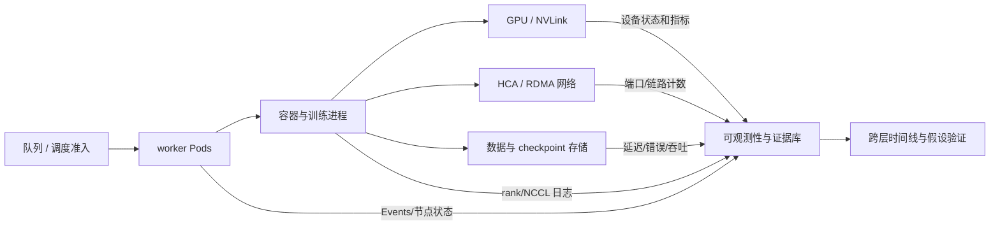
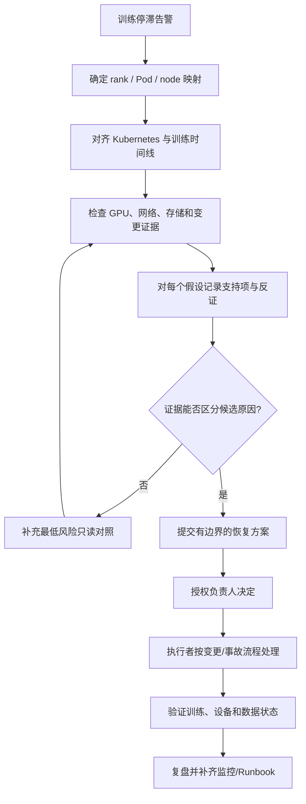
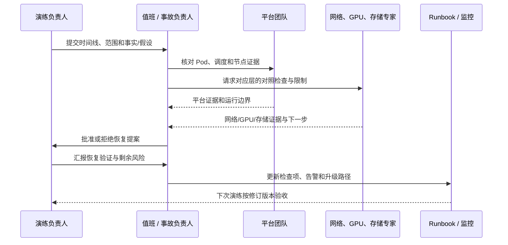

# 第 14 章：端到端实战与面试复盘

## 学习目标与岗位场景

本章把服务器、Kubernetes、GPU、网络、存储、调度和训练框架串成一套可演练的运行手册。练习采用固定证据卡，学员在不操作生产集群的情况下完成范围界定、证据关联、假设排序、跨团队协作和恢复验收设计。

端到端运维的核心不是记住某个命令，而是把每个结论追溯到数据来源，把每个状态变更关联到责任人和成功标准。跨层问题常有多个同时存在的条件；“发现了一个异常”不等于已经找到唯一根因。

## 14.1 场景：多节点训练在 collective 阶段停滞

演练中，一个 8-rank 多节点训练任务在 collective 阶段无进度。给出的证据卡如下：

| 观察项 | 已知证据 | 解释边界 |
| --- | --- | --- |
| Kubernetes | 8 个 worker Pod 均为 Running；未发现新的调度失败事件 | Running 不证明容器内训练正常 |
| 训练日志 | 多数 rank 等待同一 collective；rank 3 首先记录 timeout | timeout 仍是症状，需看此前 rank 日志 |
| GPU | 采集窗口内没有新增 Xid 事件 | 不能排除其他 GPU、驱动或采集缺口 |
| 网络 | worker-3 对应 HCA 端口错误计数在故障窗口增长 | 需确认增量、端口方向、交换机侧和同路径对照 |
| 存储 | 未取得同一时间窗的读延迟和 checkpoint 指标 | 当前未知，不能排除输入/存储等待 |
| 调度/变更 | 当天没有记录到集群变更 | 变更记录缺失不等于没有变更 |

先把事实与假设分开：网络计数增量与故障窗口相关，因此值得优先核验；但没有计数器基线、交换机端口和健康作业对照，就不能宣布链路故障。排查应确认 rank 到 Pod/节点/GPU/HCA 的映射，检查所有 rank 的首错时间，对比同节点其他作业、同作业其他节点及存储指标。

**图 14-1：端到端训练路径及可观察边界。**



## 14.2 从发现到验证的演练顺序

1. **确定范围：** 任务 ID、所有 rank、Pod、节点、GPU、HCA、队列和存储路径；记录用户影响与最后正常时间。
2. **保全证据：** 只读收集 Pod/Events、训练日志、DCGM/GPU 信息、HCA/交换机计数、存储指标与近期变更记录。
3. **对齐时间：** 统一时区并标记采集延迟；找出不同 rank 首个偏离点，关联网络计数变化。
4. **形成假设：** 至少列出网络路径、rank/进程异常、存储阻塞、GPU/驱动及集群调度等候选；为每个假设写支持证据和反证。
5. **选择低风险检查：** 优先做只读对照和配置比对。任何带负载的通信/存储基准测试只在隔离资源、获批窗口和确认不会影响共享网络/存储后进行。
6. **设计恢复：** 明确暂停新提交、切换资源池或重试作业的收益、风险、批准人、checkpoint 保护、退出条件及服务验证。
7. **复盘：** 写明已确认根因或“根因未定”、恢复结果、数据缺口、行动项与负责人。

**图 14-2：证据驱动的跨层排障和决策。**



演练只要求提出动作方案，不在生产执行。真实恢复路径必须结合训练框架的弹性能力、checkpoint 完整性、调度控制器和团队权限另行批准。若根因不确定，允许结论为“当前证据不足”；强行挑选一个根因会降低事故记录的可信度。

## 14.3 建立可复用的端到端运行手册

每个运行手册包含触发条件、适用范围、前置权限、只读证据采集、判定分支、升级联系人、允许动作、禁止动作、批准人、回滚/停止条件、恢复验收和记录模板。链接到确切组件版本文档，并说明哪些步骤只适用于特定 GPU、网络、存储或调度实现。

一个有用的验收矩阵包括：

| 层 | 运行前 | 故障中 | 恢复后 |
| --- | --- | --- | --- |
| 调度与 Pod | 队列准入、资源与节点放置记录 | Pending/Events、重启、节点条件 | worker 数量、队列状态、稳定运行 |
| GPU | 型号/拓扑、驱动和健康基线 | Xid/ECC、可见性、指标新鲜度 | 设备健康及代表性作业验证 |
| 网络 | 端口/拓扑、MTU/GID、错误计数基线 | rank 日志与端口/交换机增量 | 受控连通性/性能验证 |
| 存储 | 挂载、权限、读写基线和 checkpoint 策略 | 延迟、错误、容量、路径状态 | 数据完整性与读写恢复 |
| 训练 | 配置、world size、基线吞吐 | rank 首错、collective 与 step 时间 | 训练进度、正确性和 checkpoint |

性能基线需记录硬件型号、GPU/NIC 拓扑、软件版本、输入数据、作业参数、测量窗口和统计口径。没有这些元数据的数字不能作为跨集群验收门槛。

**图 14-3：演练结果进入值班和持续改进闭环。**



## 14.4 实践：只读跨层故障桌面演练

**前提：** 两人或小组；本章 14.1 的固定证据卡；纸面表格或文档。此练习可完全离线完成。若使用集群命令，只限授权只读环境；先设置并核对 KUBE_CONTEXT，确认它指向授权目标。GPU/RDMA 主机命令须在获批的受影响 worker 或诊断节点执行，不能在运维工作站上假设它们查询了 Kubernetes context 指向的节点。命令输出、交换机和文件系统监控可用性均需目标环境验证。

**步骤/命令：** 先离线填写一张表，每个候选原因填写“证据、反证、缺失数据、下一项低风险检查、升级团队”五栏。之后可在授权只读环境采集以下信息，并将敏感字段脱敏。先设置已核对的 KUBE_CONTEXT，并从获批作业信息中取得 NAMESPACE、JOB_SELECTOR、TRAINER_CONTAINER 和 LOG_START_TIME（故障窗口开始前的 RFC3339 时间）：

```bash
: "${KUBE_CONTEXT:?Set and verify the approved context name}"
: "${NAMESPACE:?Obtain from approved job information}"
: "${JOB_SELECTOR:?Obtain the approved label selector for this training job}"
: "${TRAINER_CONTAINER:?Obtain from approved job information}"
: "${LOG_START_TIME:?Set an RFC3339 timestamp before the fault window}"
PODS="$(kubectl --context "$KUBE_CONTEXT" get pods -n "$NAMESPACE" -l "$JOB_SELECTOR" -o name)"
: "${PODS:?The approved selector matched no pods; verify job information}"
kubectl --context "$KUBE_CONTEXT" get pods -n "$NAMESPACE" -l "$JOB_SELECTOR" -o wide
kubectl --context "$KUBE_CONTEXT" get events -n "$NAMESPACE" --sort-by=.metadata.creationTimestamp
kubectl --context "$KUBE_CONTEXT" get nodes -o wide
LOG_FAILURE=0
for POD in $PODS; do
  echo "--- $POD ---"
  if ! kubectl --context "$KUBE_CONTEXT" logs -n "$NAMESPACE" "$POD" -c "$TRAINER_CONTAINER" --since-time="$LOG_START_TIME"; then
    LOG_FAILURE=1
    echo "Log collection failed; record this worker as missing evidence." >&2
  fi
done
if [ "$LOG_FAILURE" -ne 0 ]; then
  echo "At least one worker log is missing; do not treat collection as complete." >&2
  exit 1
fi
```

在各个获批受影响 worker/诊断节点上分别运行以下只读命令；`KUBE_CONTEXT` 不会改变这些主机命令的执行目标。没有授权节点 shell 时，从批准的监控平台查询同一时间窗，并把不可用证据标记为未知：

```bash
nvidia-smi -q -d ECC
rdma link show
```

网络和 GPU 命令是否安装、权限如何、设备是否支持相应字段，以目标主机为准；不能为完成练习而在生产发起带宽压测、重启、驱动 reset、Pod 删除或节点排空。最后写一个仅供评审的恢复提案，不执行提案。

**预期结果：** 记录至少三个候选原因，并把网络路径列为优先验证方向，而不是已确认根因。下一步应核对 HCA/交换机计数器变化是否同一时间窗、rank/端口映射、同节点对照，以及存储延迟；同时检查 rank 3 之前的错误。提案需有事故负责人、影响面、批准边界和恢复验证。

**验证方法：** 用本章证据卡核对每个结论；事实均能指回表格，推断带有验证条件。没有证据证明唯一根因时，结论应保持“未定”。若提案要求压测/重启而没有隔离和批准条件，演练不通过。

**清理：** 离线演练无需清理。只读命令不修改集群；保存结果时执行脱敏和访问控制。

## 本章产出与验收

最终产出为端到端运行手册、证据矩阵、桌面演练记录和复盘行动项。验收应能从作业 ID 追踪到 rank、Pod、节点、GPU、HCA 和存储路径；解释已知/未知；给出跨团队检查顺序；设计安全的恢复审批与验证闭环。固定证据卡仅用于训练推理能力，不构成任何生产根因结论。

## 章末面试题

1. **一个多节点训练卡在 collective，第一步如何确定影响范围？**  
   要点：枚举 rank、Pod、节点、GPU、HCA、队列、作业时间和用户影响。
2. **Rank 3 出现 timeout，能否认定 rank 3 所在节点是根因？**  
   要点：不能；它可能只是最先报告超时的参与者，要检查各 rank 首错及映射。
3. **HCA 错误计数在异常窗口增长，下一步要看什么？**  
   要点：增量基线、时间对齐、端口/交换机路径、同节点和同作业对照、训练首错。
4. **GPU 没有新增 Xid 事件代表什么？**  
   要点：只表示当前采集到的该类证据未变化，不排除采集盲区或其他 GPU/软件问题。
5. **为什么要把事实和假设分列？**  
   要点：避免把相关性写成因果，保留可证伪性和后续审计能力。
6. **存储指标缺失时，应如何处置这个未知项？**  
   要点：记录缺口，向存储团队获取对齐窗口的数据；不可按健康处理。
7. **何时能运行通信基准测试？**  
   要点：隔离资源、获批窗口、确认对共享网络影响并制定停止条件后。
8. **恢复提案必须包含哪些部分？**  
   要点：目的、影响面、证据、收益/风险、批准人、checkpoint、停止/回滚条件和验收。
9. **如何证明恢复不只是 Pod 变成 Running？**  
   要点：验证 rank/训练进度、正确性、通信、设备和数据路径及 checkpoint。
10. **没有找到唯一根因，复盘还能关闭吗？**  
    要点：可以如实标为未定，但须列清证据缺口、剩余风险、后续负责人和期限。
11. **怎样将演练转化为持续改进？**  
    要点：对缺失信号、响应延迟和误判建立有验收标准的监控、Runbook 或流程行动项。
12. **为什么性能基线不能脱离硬件和参数比较？**  
    要点：拓扑、软件、数据、并行配置和测量口径都会改变结果。

## 官方资料

- Kubernetes 调试应用：<https://kubernetes.io/docs/tasks/debug/debug-application/>
- Kubernetes 调试节点：<https://kubernetes.io/docs/tasks/debug/debug-cluster/>
- NVIDIA NCCL Troubleshooting：<https://docs.nvidia.com/deeplearning/nccl/user-guide/docs/troubleshooting.html>
- NVIDIA Xid Errors：<https://docs.nvidia.com/deploy/xid-errors/index.html>
- NVIDIA DCGM Exporter：<https://github.com/NVIDIA/dcgm-exporter>
- Prometheus 查询基础：<https://prometheus.io/docs/prometheus/latest/querying/basics/>
- Kueue 概念：<https://kueue.sigs.k8s.io/docs/overview/>

## 面试复盘方法

回答综合场景题时，按“范围和影响 -> 已知事实 -> 候选假设 -> 低风险验证 -> 决策与协作 -> 恢复验收 -> 复盘改进”的顺序作答。说明你还不知道什么，比过早声称根因更能体现生产判断力。把实际经历与桌面推演分开陈述，不能将课程案例说成生产事故经验。
