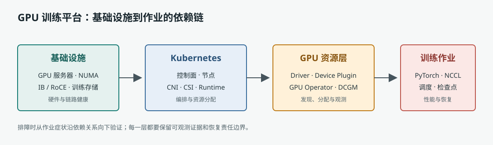

# 大规模 GPU Kubernetes 训练集群运维

本书面向负责 AI 训练基础设施的运维工程师，按服务器、操作系统、Kubernetes、GPU 软件栈、训练网络与存储、调度、故障处理和生产保障逐层展开。

正文按 14 章递进。每章配有不少于三幅技术图、一个可执行或可验证的实践、章末面试题和参考答案要点。实验会说明前提、预期结果及验证边界；依赖真实 GPU、RDMA 或共享存储的内容，必须在对应设备上验证，不能用模拟结果替代。

## 学习顺序

1. **基础环境：** 第 1-4 章，建立从服务器到 Kubernetes Pod 的资源和故障链路。
2. **训练依赖：** 第 5-9 章，掌握 GPU、网络、分布式通信和训练存储。
3. **生产运维：** 第 10-14 章，练习调度、故障处置、自动化、变更和端到端演练。

仓库根目录的 `README.md` 列出章节目标、招聘要求映射和全书验收标准。

## 实验边界

- 通用 Linux 和 Kubernetes 实验可在个人虚拟机或隔离的本地集群执行。
- GPU、驱动、固件、RDMA、交换机和共享存储实验需要对应设备与获批环境。
- 任何可能影响工作负载或集群服务的操作，都只提供实验环境步骤或变更方案，不应直接对生产环境执行。

## 图表说明

本书图表使用 Mermaid 描述并由站点构建渲染。图表中的拓扑和流程是解释模型；具体端口、版本、链路速率和厂商配置以现场资产及官方文档为准。
